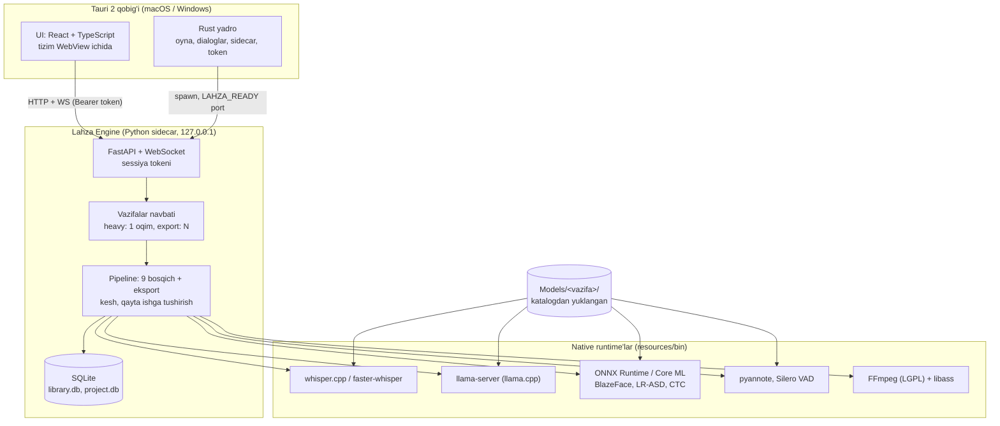
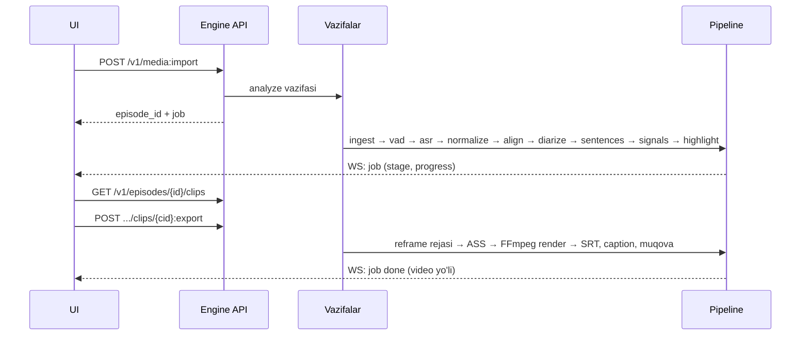

# Arxitektura

Lahza Studio — uch qatlamli, to'liq oflayn desktop dastur. UI hech qachon modelni yoki FFmpeg'ni bevosita chaqirmaydi: u faqat engine API'si bilan gaplashadi, engine esa og'ir hisobni native runtime'larga topshiradi.

## Qatlamlar va mas'uliyat

| Qatlam | Texnologiya | Mas'uliyat | Mas'uliyati emas |
| --- | --- | --- | --- |
| UI | React 19, TypeScript, TanStack Query, Zustand, React Router (hash) | Ekranlar, preview, tahrir, foydalanuvchi sozlamalari (`localStorage`) | Hisob-kitob, fayl tizimi, tarmoq |
| Rust yadro | Tauri 2, tauri-plugin-shell, tauri-plugin-dialog | Sidecar'ni ishga tushirish/o'ldirish, token, port, fayl dialoglari | Biznes mantiq |
| Engine | Python 3.12, FastAPI, uvicorn, pydantic, SQLite | Pipeline, ma'lumot, model menejeri, render | UI holati |
| Runtime'lar | whisper.cpp, llama.cpp, ONNX Runtime, FFmpeg | Og'ir hisob (GPU/ANE) | Holat saqlash |

## Jarayon modeli

1. Foydalanuvchi ilovani ochadi → Rust yadro tasodifiy 256-bit token yaratadi va `lahza-engine serve --port 0` ni sidecar sifatida ishga tushiradi (`app/src-tauri/src/engine.rs`).
2. Engine bo'sh portni tanlaydi, faqat `127.0.0.1` ga bog'lanadi va stdout'ga `LAHZA_READY port=NNNN` yozadi.
3. Rust portni saqlaydi; UI `invoke("engine_info")` orqali port va tokenni oladi (`app/src/api/client.ts`).
4. Har HTTP so'rov `Authorization: Bearer <token>` bilan; `<video>` va WebSocket uchun `?t=<token>`.
5. Engine qulasa — Rust 1…5 s kutib, ko'pi bilan 5 marta qayta ishga tushiradi; UI keyingi `engine_info` chaqiruvida yangi portni oladi.
6. Ilova yopilganda engine to'xtatiladi; engine o'z navbatida `llama-server`, ffmpeg kabi bola jarayonlarni o'ldiradi ("Engine hayot sikli" pastda).

### Engine hayot sikli (yetim jarayonlar himoyasi, 0.2.1)

Sidecar PyInstaller **onefile**: bitta engine = ikki jarayon (bootloader + Python bolasi). 0.2.0 gacha
Tauri faqat bootloader'ga SIGKILL yuborardi - Python bolasi yetim qolardi; `/v1/events` WebSocket
handler'i uzilishni sezmay osilib qolgani uchun yetim engine SIGTERM'ga ham javob bermasdi.
Himoya qatlamlari:

* **Rust** (`engine.rs`): sidecar alohida jarayon guruhida (`set_process_group`); `RunEvent::Exit` da
  guruhga SIGTERM → 2,5 s kutish → SIGKILL. Ilovaga kelgan SIGTERM/SIGINT/SIGHUP ham shu yo'lga.
* **Python** (`core/lifecycle.py`, `cli._run_server`): SIGTERM/SIGINT da uvicorn `should_exit`,
  `timeout_graceful_shutdown=2`, 5 s dan oshsa `os._exit`; chiqishda barcha avlod jarayonlar SIGKILL.
* **Watchdog** (force quit/crash, Rust kodi ishlamaganda): Tauri `--parent-pid <pid> --watch-stdin`
  uzatadi; ota pid yo'qolsa, stdin pipe EOF bo'lsa yoki bootloader o'lib ppid o'zgarsa engine ~1 s
  ichida o'zini to'xtatadi.

Engine'ga uzatiladigan muhit o'zgaruvchilari:

| O'zgaruvchi | Ma'nosi |
| --- | --- |
| `LAHZA_TOKEN` | Sessiya tokeni |
| `LAHZA_BIN_DIR` | `ffmpeg`, `ffprobe`, `whisper-cli`, `llama-server` papkasi (ilova resurslari) |
| `LAHZA_CATALOG` | Model katalogi yo'li |
| `LAHZA_CATALOG_PUBKEY` | Katalog imzosini tekshirish uchun Ed25519 ochiq kaliti (build vaqtida) |
| `LAHZA_DATA_DIR` | (ixtiyoriy) Ma'lumotlar papkasi; standart: macOS `~/Library/Application Support/Lahza Studio`, Windows `%LOCALAPPDATA%\Lahza Studio` |
| `LAHZA_DEV` | `1` — dasturchi rejimi (imzosiz katalog, dasturiy enkoder zaxirasi) |

## Ma'lumot oqimi

## Modul xaritasi (engine)

| Paket | Vazifasi | TZ bo'limi |
| --- | --- | --- |
| `text/` | Imlo normallashtirish, 3 rejim, gaplarga bo'lish | 9 |
| `asr/` | Backend interfeysi, whisper.cpp, faster-whisper, bo'laklash | 5 |
| `vad/` | Silero (asosiy), energiya (zaxira) | 6 |
| `align/` | CTC forced alignment | 6 |
| `diarize/` | pyannote, so'zlarga biriktirish | 6 |
| `highlight/` | Signallar, qoidalar, LLM map/reduce, chegaralar, ball, NMS | 7 |
| `reframe/` | Yuz aniqlash, treker, ASD birlashmasi, kamera yo'li, layoutlar | 8 |
| `subtitle/` | Maketlash, ASS/SRT, uslub shabloni | 9 |
| `render/` | FFmpeg grafi, enkoder tanlovi, platforma limitlari | 10 |
| `models/` | Apparat, daraja, katalog, imzo, yuklab olish, ombor | 2, 13 |
| `core/` | Kesh, bosqich bajaruvchisi, tahlil, eksport, vazifalar, hodisalar, llama-server | 4 |
| `db/` | SQLite sxema va ombor | 12 |
| `api/` | HTTP/WS API | 3 |

## Xatolarga chidamlilik

* Har bosqich natijasi `cache/<bosqich>-<kalit>.json` ga yoziladi, holati `stage_runs` jadvalida. Qayta ishga tushirishda tugagan bosqichlar keshdan olinadi (`core/runner.py`).
* Kesh kaliti yuqori oqim kalitlarini o'z ichiga oladi: parametr o'zgarsa, faqat undan keyingi bosqichlar qayta hisoblanadi.
* Qo'lda tahrirlangan so'zlar (`words.edited = 1`) va foydalanuvchi tahrirlagan/qabul qilgan kliplar qayta tahlilda ustiga yozilmaydi.
* ASR modeli yo'q → tahlil aniq xabar bilan to'xtaydi. LLM yo'q → Lite rejim. Yuz detektori yo'q → "xira fon" layouti. Silero yo'q → energiya VAD.

## Xavfsizlik chegaralari

* Engine faqat `127.0.0.1` da, tasodifiy port, har sessiyada yangi token (NFR-08).
* FFmpeg va boshqa dasturlar shell'siz, argumentlar massivi bilan chaqiriladi (`media/tools.py`). Filtergraph fayllari ish papkasida, ffmpeg `cwd` bilan ishlaydi — foydalanuvchi yo'llari grafga kirmaydi.
* LLM javobi — faqat ma'lumot: JSON sxemadan o'tmagan yoki oynadan tashqaridagi nomzod tashlanadi (NFR-09); promptda transkriptdagi "buyruq"larga amal qilmaslik qoidasi bor.
* Katalogdan tashqari model fayllari sarlavha bo'yicha tekshiriladi (GGUF); bajariladigan fayllar rad etiladi; hech narsa ishga tushirilmaydi (`models/store.py`).
* Frontend'ga shell ruxsati berilmaydi — sidecar faqat Rust tomondan (`capabilities/default.json`).
* CSP faqat `127.0.0.1` dagi engine'ga ulanishga ruxsat beradi (`tauri.conf.json`).

## Arxitektura qarorlari

Har bir muhim qaror `docs/adr/` da: kontekst, qaror, oqibatlar. Ro'yxat: [`adr/README.md`](adr/README.md).
