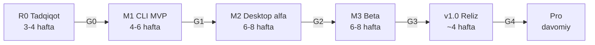

# Yo'l xaritasi: 0 dan Pro gacha

Ish oltita bosqichda boradi. Har bosqich o'lchanadigan **darvoza** (gate) bilan yopiladi: darvozadan o'tmasa, bosqich uzayadi va keyingisi boshlanmaydi. Muddatlar — jamoa tarkibiga bog'liq taxmin (TZ 19-bo'lim).

Belgilar:
* `[x]` — shu repozitoriyda bajarilgan va testlangan (haqiqiy model/apparat talab qilmaydi);
* `[~]` — **kod tayyor va testlangan** (soxta/kichik modellar, mock bilan), lekin haqiqiy model, apparat yoki tashqi resurs bilan hali sinalmagan — odatda R0'da model bilan tasdiqlanadi. Izohda nima qolgani yozilgan;
* `[ ]` — qilinishi kerak.

Har vazifada ID bor (kod va PR'larda shu ID'ga havola qilinadi).

## Hozirgi holat (2026-10-20)

Tekshiruv: engine `pytest` — **327 passed, 2 skipped** (libass'siz FFmpeg); `ruff` toza; UI typecheck + build o'tadi; jonli engine'ga qarshi 102 endpoint tekshiruvi o'tdi; montaj uchun jonli 215 tekshiruv o'tdi (6 o'rnatilgan shablon bilan haqiqiy montaj va render, 9:16 / 1:1 / 16:9, audio-video sinxron, `_edl.json` da `"haqiqiy_kadr": true`); brauzerda onboarding, galereya, klip muharriri, transkript, sozlamalar, shablonlar galereyasi va montaj muharriri konsol xatosisiz ishlaydi. Haqiqiy ASR/LLM/ko'rish modellari bilan sinov — R0.

| Qism | Holat | Qayerda |
| --- | --- | --- |
| O'zbek imlosi: normallashtirish, 3 rejim | Ishlaydi, testlangan | `engine/src/lahza_engine/text/` |
| Tinish belgisi / katta harf tiklash (qoidaviy) | Ishlaydi, testlangan; `stage_normalize` ga ulangan | `text/punctuation.py`, `core/analyze.py` |
| Gaplarga bo'lish, chegaralarni tekislash, jarimalar | Ishlaydi, testlangan | `highlight/boundaries.py`, `rules.py` |
| Signal xususiyatlari (ovoz, nutq tezligi, savol) | Ishlaydi, testlangan; kulgi detektori — interfeys | `highlight/signals.py` |
| Lite highlight (LLM'siz) | Ishlaydi, testlangan | `highlight/finder.py` |
| LLM map/reduce, JSON sxema, prompt, llama-server | Kod va testlar bor; haqiqiy model bilan R0'da sinaladi | `highlight/llm.py`, `schema.py`, `core/llama_server.py` |
| VAD: Silero ONNX (torch'siz) + energiya zaxirasi | Kod tayyor, testlangan; haqiqiy model bilan R0 | `vad/silero_onnx.py`, `vad/energy.py` |
| ASR backendlari, hotwords (lug'at) | Kod bor; model bilan R0'da sinaladi | `asr/`, `core/analyze.py` |
| CTC forced alignment: vektorlashtirilgan Viterbi, ONNX aligner, `stage_align`, gapni qayta tekislash | Algoritm va ulanish testlangan; akustik model — R0 | `align/ctc.py`, `ctc_onnx.py`, `realign.py` |
| Diarizatsiya: pyannote oflayn, S1/S2 yorliqlar, ustma-ustlik | Biriktirish va yorliqlar testlangan; model — R0 | `diarize/assign.py`, `core/services.py` |
| Xizmatlar zaxira zanjirlari (model yo'q bo'lsa zaxiraga o'tish) | Ishlaydi, testlangan | `core/services.py` |
| ASS karaoke/pop subtitr, kalit so'z, filler tozalash, so'kinish maskasi, SRT/VTT, xavfsiz zona | Ishlaydi, testlangan | `subtitle/` |
| Shablon import/eksport (versiyali), shrift glif testi | Kod testlangan; `subtitle/fonts/` **bo'sh** — real shriftlar qo'shilmagan | `subtitle/style.py`, `fonts.py` |
| Reframe: One-Euro, o'lik zona, layoutlar, avtomatik split + min hold, qo'lda kalit kadrlar | Ishlaydi, testlangan; ASD (LR-ASD) — yo'q | `reframe/` |
| Yuz aniqlash: BlazeFace ONNX → mediapipe → xira fon | Kod testlangan; real model bilan R0; Core ML — yo'q | `reframe/faces.py`, `core/services.py` |
| Sahna kesimlari (ffmpeg `scdet`) | Ishlaydi, testlangan | `media/scenes.py` |
| FFmpeg render grafi (focus/split/xira fon, kesimlar, loudnorm, logo, preview kadr) | Haqiqiy FFmpeg bilan testlangan; libass'li subtitr render bu muhitda skip | `render/graph.py` |
| Subtitrsiz rejim (`LibassMissing`), platforma limitlari ogohlantirishi | Ishlaydi, testlangan | `render/capabilities.py`, `limits.py` |
| Enkoder tanlovi (VideoToolbox/NVENC/AMF/QSV/MF) | Kod bor; apparatda R0'da sinaladi | `render/encoders.py` |
| Pipeline: kesh, qayta ishga tushirish, bekor qilish | Ishlaydi, testlangan (soxta ASR bilan uchidan-uchigacha) | `core/` |
| SQLite sxema: kutubxona v3 (montaj jadvallari), loyiha v2; migratsiya, `corrections` | Ishlaydi, testlangan | `db/` |
| Apparat aniqlash va daraja | Ishlaydi, testlangan | `models/hardware.py` |
| Model katalogi: imzo, avtomatik to'plam | Ishlaydi, testlangan; katalogda hali `approved` model yo'q | `models/catalog.py`, `catalog/` |
| Yuklab olish, model ombori; o'chirish/standart/sinov | Ishlaydi, testlangan | `models/downloader.py`, `store.py`, `api/routes_models.py` |
| `.lzpack` eksport/import (sha256, ixtiyoriy Ed25519, zip-slip himoya) | Ishlaydi, testlangan | `models/lzpack.py` |
| Montaj: Lahza Timeline `lahza.timeline/1` (video trek + o'tishlar, matn qatlami, musiqa, captions, brand, audio, color, provenance) | Ishlaydi, testlangan; Reels klip renderi hali eski `RenderJob` orqali | `montage/model.py` |
| Video shablonlar `lahza.template/1`: 6 o'rnatilgan (4 tilda), import/eksport, validatsiya, o'rinbosarlar | Ishlaydi, testlangan | `templates/` |
| Lahza FX `lahza.fx/1`: 22 o'rnatilgan plagin, oq ro'yxat, GPL filtrlar taqiqi (`check_graph`) | Ishlaydi, testlangan; `.lzfx` paket — yo'q | `fx/` |
| Montaj tahlili (sahna, keskinlik, harakat, energiya, nutq; kesh) va deterministik rejalashtiruvchi (trigger'lar, intro/hook/outro, captions, musiqa) | Ishlaydi, testlangan; LLM reja — yo'q | `montage/analyze.py`, `planner.py` |
| Montaj renderi (2 bosqich, xfade, rang, kartalar, ASS, logo, musiqa + ducking, loudnorm), preview kadr, `_edl.json` | Haqiqiy FFmpeg bilan testlangan; libass'li matn chizilishi bu muhitda skip | `render/montage_render.py`, `montage/report.py` |
| Montaj API: `/v1/fx`, `/v1/templates*`, `/v1/montages*` | Ishlaydi, testlangan; jonli 215 tekshiruv | `api/routes_montage.py` |
| UI: shablonlar galereyasi, shablon muharriri, yangi montaj, montaj muharriri, montajlar ro'yxati (4 til) | Typecheck + build o'tadi; brauzerda sinalgan | `app/src/pages/`, `components/montage/` |
| Engine API (docs/04 to'liq), WebSocket (4401), token, CORS | Ishlaydi, testlangan; jonli 102 endpoint tekshiruvi | `api/` |
| Eksport navbati: jadval, qayta urinish, `LAHZA_EXPORT_WORKERS`, fayl nomi shabloni | Ishlaydi, testlangan | `core/export.py`, `core/jobs.py` |
| Aylanadigan loglar, diagnostika zip (transkriptsiz) | Ishlaydi, testlangan | `core/logs.py`, `core/diagnostics.py` |
| Desktop ilova: Tauri qobig'i, sidecar boshqaruvi | Kod bor; bu muhitda `cargo check` ishlatilmagan (Rust yo'q); save-dialog ruxsati — ochiq | `app/src-tauri/` |
| UI: onboarding, loyihalar, galereya, transkript muharriri, klip muharriri (timeline, preview, tablar), eksport navbati, sozlamalar (modellar, `.lzpack`, imkoniyatlar, lug'at, diagnostika) | Typecheck + build o'tadi; brauzer rejimida engine bilan qo'lda sinalgan | `app/src/` |
| i18n: uz, uz-Cyrl, ru, en (338 kalit, TS bilan majburiy) | Ishlaydi | `app/src/i18n/` |
| CI va reliz workflow'lari, PR/issue shablonlari, versiya/litsenziya skriptlari | Yozilgan; GitHub'da hali ishga tushirilmagan | `.github/`, `scripts/` |

**Montaj bo'yicha keyinga qolganlar:** YouTube import (YT-1), NLE eksport (NLE-1), Lottie, musiqa zarbi, LLM reja, multicam, `.lzfx` import UI, libass'li matn chizilishi sinovi — [docs/11, 13-bo'lim](11-montaj-platformasi.md#13-yol-xaritasi).

**Tashqi resurs talab qiladigan, hali bajarilmagan:** R0 ma'lumot to'plamlari va model o'lchovlari; katalogda `approved` modellar; native runtime'lar yig'ish; imzolash/notarizatsiya; yurist xulosasi; Rust `cargo check`; Tauri save-dialog ruxsati; LR-ASD; Core ML; libass'li render sinovi; real shriftlar; kirill subtitr; Pro bandlari; litsenziya kaliti.

---

## R0 — Tadqiqot va asos (taxmin 3–4 hafta)

Maqsad: **modellarni sizning podkastlaringizda o'lchab tanlash** va eng xavfli texnik joylarni erta yopish. R0 tugamaguncha UI ustida katta ish boshlanmaydi.

### Repozitoriy va jarayon
- [x] R0-ORG-1 Monorepo tuzilmasi, hujjatlar, ADR'lar
- [~] R0-ORG-2 CI: engine testlari (macOS, Windows, Linux), frontend build, Rust check — `.github/workflows/ci.yml` yozilgan; GitHub'da hali ishga tushirilmagan
- [~] R0-ORG-3 Git repozitoriy, branch qoidalari, PR shabloni (`CONTRIBUTING.md`) — `CONTRIBUTING.md`, PR va issue shablonlari bor; git repozitoriy va branch qoidalari yo'q
- [ ] R0-ORG-4 Apple Developer Program a'zoligi, Windows kod imzolash sertifikati (muddat uzoq — erta boshlash)

### Ma'lumot to'plamlari (TZ 15-bo'lim)
- [ ] R0-DATA-1 **UzPodcast-Eval**: 3–5 soat real podkast audio; ≥10 spiker; erkak/ayol; Toshkent, Farg'ona vodiysi, Samarqand, Xorazm shevalari; rus/ingliz aralash nutq; musiqa kirishi; ustma-ust gaplashish
- [x] R0-DATA-2 Transkripsiya yo'riqnomasi (`eval/YORIQNOMA.md`)
- [ ] R0-DATA-3 UzPodcast-Eval uchun qo'lda etalon transkript (yo'riqnoma bo'yicha, ikki kishi tekshiradi)
- [ ] R0-DATA-4 **Align-Eval**: 30 daqiqa, so'z chegaralari qo'lda
- [ ] R0-DATA-5 **UzHighlight-Eval**: 10 epizod, 3 SMM mutaxassisi mustaqil highlight belgilaydi
- [ ] R0-DATA-6 **Reframe-Eval**: 10 video, har soniyada aktiv spiker belgilangan

### ASR (TZ 5-bo'lim)
- [ ] R0-ASR-1 Nomzodlarni yuklash va formatlarga o'girish: GGML (whisper.cpp), CTranslate2 (faster-whisper), ONNX (piyola-v2 / NeMo)
- [x] R0-ASR-2 O'lchov skripti (`eval/run_asr_eval.py`: WER, CER, RTF)
- [ ] R0-ASR-3 Har apparat darajasida o'lchash; ismlar aniqligi; sukut/musiqada "o'ylab topish" ulushi
- [ ] R0-ASR-4 Qaror: daraja bo'yicha asosiy + zaxira model; katalogda `approved` (sha256, hajm, URL)
- [ ] R0-ASR-5 whisper-cli bayroqlarini (`-ml 1 -sow -oj`) mahkamlangan versiya bilan tasdiqlash

### So'z vaqtlari va diarizatsiya (TZ 6-bo'lim)
- [x] R0-ALN-1 CTC Viterbi algoritmi (numpy) va testlar
- [~] R0-ALN-2 Omnilingual CTC o'zbek tilini qo'llashini tekshirish; emissiya adapteri (`align/`) — ONNX adapter (`align/ctc_onnx.py`) tayyor; o'zbek tilini qo'llashi model bilan tekshirilmagan
- [ ] R0-ALN-3 Align-Eval: median ≤ 80 ms, p95 ≤ 250 ms maqsadini tasdiqlash yoki tuzatish
- [~] R0-DIA-1 pyannote community-1 ni oflayn papkadan ishga tushirish; Core ML porti (Mac) sinovi — oflayn yuklash kodi tayyor; real model va Core ML sinovi qolgan

### LLM (TZ 7-bo'lim)
- [x] R0-LLM-1 JSON sxema, prompt, map/reduce, javobni tekshirish
- [ ] R0-LLM-2 Qwen3.5 (4B, 9B), Gemma 4 (26B A4B), NeuronAI-2B, alloma-8B — GGUF Q4_K_M; UzHighlight-Eval: precision@5, IoU ≥ 0.5 topish ulushi, JSON yaroqliligi, sarlavha bahosi 1–5, token/s
- [ ] R0-LLM-3 O'zbekcha va inglizcha prompt solishtirish
- [ ] R0-LLM-4 Oyna/ustma-ustlik va ball vaznlarini tanlash (`config.py` dagi "R0" qiymatlar)
- [ ] R0-LLM-5 llama-server `response_format: json_schema` qo'llovini mahkamlangan versiyada tasdiqlash

### Ko'rish (TZ 8-bo'lim)
- [~] R0-VIS-1 BlazeFace ONNX (Windows) va Core ML (Mac) — `reframe/faces.py` ga backend — ONNX backend tayyor (kod tayyor; R0'da model bilan tasdiqlanadi); Core ML — yo'q
- [ ] R0-VIS-2 LR-ASD ONNX backend; `reframe/speaker_map.py` bilan birlashtirish
- [ ] R0-VIS-3 One-Euro va AutoFlip uslubidagi optimal yo'lni Reframe-Eval'da solishtirish; `ReframeConfig` qiymatlari

### Runtime va qadoqlash
- [ ] R0-RT-1 `third_party/runtimes.toml` versiyalarini mahkamlash; `scripts/build_runtimes.*` bilan whisper.cpp, llama.cpp, LGPL FFmpeg yig'ish (Mac arm64, Windows x64)
- [ ] R0-RT-2 Enkoderlarni haqiqiy apparatda sinash (VideoToolbox, NVENC, AMF, QSV, MF)
- [ ] R0-PKG-1 "Salom dunyo" reliz: PyInstaller sidecar + Tauri, Mac'da notarizatsiya + staple, Windows'da imzo — internetsiz VM'da ishga tushadi
- [ ] R0-LEG-1 Yurist xulosasi: FFmpeg yig'masi, NVENC, H.264 patentlari, litsenziyasi noaniq modellar

**G0 darvozasi:** har platforma va darajada ≥1 `approved` ASR modeli; LLM tanlandi (yoki Lite qarori); baseline o'lchovlar `eval/results/` da; R0-PKG-1 ishlaydi.

---

## M1 — CLI MVP (taxmin 4–6 hafta)

Maqsad: `lahza analyze` → `lahza export` ikkala platformada haqiqiy modellar bilan uchidan-uchigacha ishlaydi.

- [x] M1-PIPE-1 Bosqichlar, kesh kaliti, qayta ishga tushirish, bekor qilish
- [x] M1-PIPE-2 Ingest: ffprobe, tez xesh, 16 kHz WAV, 540p proksi
- [x] M1-PIPE-3 Energiya VAD zaxirasi; bo'laklash ≤ 30 s
- [~] M1-PIPE-4 Silero VAD (ONNX) — asosiy — `vad/silero_onnx.py`, torch'siz; kod tayyor; R0'da model bilan tasdiqlanadi
- [~] M1-ASR-1 R0'da tanlangan ASR backendlarini ulash; lug'at (hotwords) — hotwords va zaxira zanjiri ulangan; ASR modeli R0'da tanlanadi
- [x] M1-ASR-2 Tinish belgisi/katta harfni tiklash (model bermasa) — qoidaviy tiklagich, `stage_normalize`
- [~] M1-ALN-1 CTC aligner'ni pipeline'ga ulash (`stage_align`) — ulangan, vektorlashtirilgan Viterbi; kod tayyor; R0'da model bilan tasdiqlanadi
- [~] M1-DIA-1 pyannote diarizatsiyasini ulash — oflayn, S1/S2 yorliqlar, overlaps; kod tayyor; R0'da model bilan tasdiqlanadi
- [x] M1-HL-1 Lite highlight, NMS, chegaralar
- [~] M1-HL-2 LLM highlight'ni llama-server bilan uchidan-uchigacha — `core/llama_server.py` ulangan; haqiqiy GGUF model bilan sinalmagan
- [x] M1-SUB-1 ASS karaoke, SRT, xavfsiz zona
- [x] M1-RND-1 Render grafi: focus/split/xira fon, kesimlar, subtitr, audio fade
- [~] M1-RND-2 Focus layout uchun yuz aniqlashni ulash (ASD'siz: eng katta yuz) — BlazeFace ONNX → mediapipe → xira fon zanjiri; kod tayyor; R0'da model bilan tasdiqlanadi
- [x] M1-CLI-1 `lahza hw | bundle | analyze | clips | export | serve`
- [ ] M1-CLI-2 Har 10 epizodni CLI orqali ishlatib, xatolarni yopish

**G1 darvozasi:** 10 epizod boshidan oxirigacha xatosiz; TZ 15-bo'limdagi mutlaq talablar 100% (so'z kesilmaydi, JSON 100% yaroqli, 0 tarmoq so'rovi, 1080×1920, sinxron ovoz).

---

## M2 — Desktop alfa (taxmin 6–8 hafta)

- [x] M2-APP-1 Tauri qobig'i: sidecar, token, qayta ishga tushirish, ilova yopilganda o'ldirish
- [x] M2-APP-2 Ekranlar skeleti: onboarding, loyihalar, galereya, klip muharriri, eksport, sozlamalar
- [~] M2-APP-3 Onboarding: katalogdan avtomatik to'plam yuklash, progress, xatoda davom ettirish (`approved` modellar paydo bo'lgach) — ekran ishlaydi; katalogda `approved` model yo'q
- [x] M2-APP-4 Transkript muharriri: so'zni tahrirlash → faqat o'sha gap qayta tekislanadi — `/episodes/:id/transcript`, `corrections`
- [x] M2-APP-5 Matn orqali montaj: so'z/gapni o'chirish → `clip_cuts`; matnni belgilab "Klip yarat"
- [x] M2-APP-6 Timeline: to'lqin shakli, so'zlar, spiker lentalari, trim tutqichlari so'z chegarasiga yopishadi — SVG
- [~] M2-APP-7 Preview: libass WASM yoki engine preview kadrlari (R0'da tanlanadi) — ekrandagi = eksportdagi — engine preview kadri (`:preview`) tanlandi va ishlaydi; libass'li FFmpeg bilan subtitrli kadr sinovi qolgan
- [x] M2-APP-8 Eksport navbati: parallel vazifalar, fayl nomi shabloni, papkani ochish — `LAHZA_EXPORT_WORKERS`, qayta urinish, `system:reveal`
- [x] M2-APP-9 Model menejeri: standart model, o'chirish, sinov; `.lzpack` eksport/import (internetsiz kompyuter)
- [x] M2-APP-10 i18n: rus va o'zbek (kirill) lug'atlari — uz, uz-Cyrl, ru, en
- [x] M2-APP-11 Diagnostika paketi, aylanadigan loglar (transkript matnisiz)
- [~] M2-PKG-1 `scripts/build_sidecar.py` bilan har platformada sidecar; CI'da artefakt — skript va CI job bor; har platformada yig'ilmagan, CI ishga tushirilmagan

**G2 darvozasi:** 5 ichki foydalanuvchi bir hafta davomida haqiqiy ishda ishlatadi; bloklovchi xatolar yopilgan.

---

## M3 — Beta (taxmin 6–8 hafta)

- [ ] M3-RF-1 ASD + diarizatsiya birlashmasi bilan aktiv spiker
- [~] M3-RF-2 Split va xira fon layoutlarini avtomatik tanlash; minimal ushlab turish vaqti — kod tayyor; R0'da yuz/ASD modeli bilan tasdiqlanadi
- [x] M3-RF-3 Sahna kesimlari (PySceneDetect) — PySceneDetect o'rniga ffmpeg `scdet` (`media/scenes.py`)
- [x] M3-RF-4 Qo'lda layout va kalit kadrlar (UI + `reframe_keyframes`)
- [x] M3-SUB-1 Pop animatsiyasi, kalit so'zni ajratish, to'ldiruvchi so'zlarni tozalash (+ so'kinish maskasi)
- [x] M3-SUB-2 Brend shablonlari: saqlash, fayl orqali almashish — versiyali `.json`
- [~] M3-SUB-3 Shrift glif testi (ʻ ʼ Ö Ğ Ş Ç Ў Қ Ғ Ҳ) va faqat ochiq litsenziyali shriftlar — glif testi (`subtitle/fonts.py`) bor; `subtitle/fonts/` bo'sh, shriftlar qo'shilmagan
- [x] M3-SUB-4 Uch imlo rejimi (rasmiy, ASCII, yangi alifbo)
- [ ] M3-REL-1 Mac: Developer ID, hardened runtime, notarizatsiya, staple; Windows: imzo (CI)
- [ ] M3-PERF-1 Tezlik maqsadlarini (TZ 2-bo'lim jadvali) har darajada o'lchash va optimallashtirish
- [~] M3-A11Y-1 Klaviatura bilan to'liq boshqarish, kontrast — yorliqlar va a11y atributlari bor; kontrast auditi o'tkazilmagan

**G3 darvozasi:** TZ 15-bo'lim mezonlari bajarilgan; yopiq beta fikrlari yopilgan.

---

## v1.0 — Reliz (taxmin ~4 hafta)

- [ ] V1-1 Barqarorlik: 4 soatlik video, ketma-ket 20 epizod (chidamlilik testlari)
- [ ] V1-2 O'rnatuvchilar: `.dmg` (staple), NSIS; toza VM'da internetsiz o'rnatish + `.lzpack`
- [ ] V1-3 Oflayn litsenziya kaliti (Ed25519) — agar tijorat bo'lsa (TZ 19-bo'lim)
- [~] V1-4 Foydalanuvchi qo'llanmasi (o'zbekcha) — `docs/qollanma.md` joriy holat uchun; v1.0 da yakunlanadi
- [ ] V1-5 Litsenziyalar oynasi va `LICENSES-THIRD-PARTY.md` to'liq
- [ ] V1-6 Instagram limitlarini qayta tekshirish (`render/platform_limits.json`)

**G4 darvozasi:** reliz tekshiruvi (`docs/10-reliz-va-imzolash.md`) va yurist xulosasi.

---

## Pro — relizdan keyin

- [ ] PRO-1 O'z-o'zini yaxshilash: muharrir tuzatishlari (`corrections`) → lug'at → fine-tune paketi
- [ ] PRO-2 Ikki kamerali yozuv: audio kross-korrelyatsiya bilan sinxron, kamera tanlash — kengaytirilib v1.5 ga ko'chirildi: MC-1 ([`11-montaj-platformasi.md`](11-montaj-platformasi.md#13-yol-xaritasi))
- [ ] PRO-3 "Hook oldinga": eng kuchli jumla klip boshiga 2–4 s
- [ ] PRO-4 Kirill subtitr (lug'atli transliteratsiya)
- [ ] PRO-5 Partiyaviy ishlov (bir nechta epizod navbatda)
- [ ] PRO-6 Real natijalardan o'rganish: foydalanuvchi ko'rishlar sonini kiritadi → ball vaznlari moslashadi
- [ ] PRO-7 Ixtiyoriy YouTube yuklab olish plagini (alohida ogohlantirish bilan) — M3 ga ko'chirildi: YT-1 ([ADR-0010](adr/0010-youtube-havola-import.md))
- [ ] PRO-8 Windows on ARM va Linux

## Kengaytma: Lahza Montaj (qisman amalga oshirildi)

Plaginlar, retseptlar, multicam, video to'plamidan avtomontaj va montaj dasturlari bilan ko'prik — [`11-montaj-platformasi.md`](11-montaj-platformasi.md). U M3 ga qo'shimcha vazifalar (TL, NLE-1, YT-1, CLN-1) va yangi **v1.5 "Montaj"** hamda **v2.0 "Studiya"** bosqichlarini taklif qiladi (darvozalar GE1–GE3). Qabul qilingach, vazifalar shu faylga ko'chiriladi. 2026-10-20 holatiga ko'ra video shablonlar va montaj amalga oshirildi (TL-3, FX-2, FX-4, RCP-1 — `[x]`; TL-1, TL-2, FX-1, FX-3, FX-5, MNT-1…3 — `[~]`); vazifalar holati hozircha [docs/11, 13-bo'lim](11-montaj-platformasi.md#13-yol-xaritasi) da yuritiladi.

## Kengaytma: Adobe plaginlari

Lahza paneli Premiere Pro (UXP) va After Effects (CEP + ExtendScript) ichida; desktop ilova bilan bitta engine — [`12-adobe-plaginlar.md`](12-adobe-plaginlar.md), [ADR-0014](adr/0014-adobe-plaginlar.md). Kod `adobe/` da. Belgilar: `[x]` tayyor, `[~]` kod bor (Adobe'siz testlangan), `[ ]` boshlanmagan. Holat 2026-10-22.

- [ ] ADB-0 Haqiqiy host spike'i (macOS + Windows): UXP'da `http://127.0.0.1` / `localhost` ga ulanish, UXP va CEP `Origin` sarlavhasi, `minVersion`, SRT → captions, tezlik, ducking API'lari — natija `12` ning ANIQLANSIN joylariga yoziladi
- [~] ADB-1 Engine: `lahza serve --discovery` (`engine.json`, 0600), CORS (UXP/CEP origin'lari, token majburiy), `GET /v1/hostplan/schema`
- [~] ADB-2 Engine: `lahza.hostplan/1` — `plan_from_clip` (kesimlar, reframe → Scale/Position, fit_blur, split, captions, markerlar) va `:hostplan` endpointi
- [~] ADB-3 Engine: `plan_from_montage` (o'tishlar va motion fx xaritasi, rang/LUT, matn, musiqa, `not_translated`) va `/v1/montages/{id}:hostplan`
- [~] ADB-4 `adobe/shared`: `hostplan.ts` (+ `assertHostPlan`), `EngineClient` (discovery, job polling), Python ↔ TS sxema mosligi testi
- [~] ADB-5 Premiere UXP paneli: engine holati, tahlil, lahzalar, Reels, montaj, "nima o'tmadi"; `HostAdapter` (`premiere.ts` + `fake.ts`); `.ccx` paketlash
- [~] ADB-6 After Effects CEP paneli: UI + `host.jsx` (`lahza_buildComp`, undo group, kalit kadrlar, xira fon, split, o'tishlar, karaoke subtitr, musiqa ducking); ES3 va mock AE testlari; dev o'rnatish skriptlari
- [ ] ADB-7 Mustaqil "Lahza Engine" servisi (macOS LaunchAgent, Windows autostart) va plagin + engine o'rnatuvchisi
- [ ] ADB-8 Qo'lda sinov matritsasi: Premiere 25.6 / 26.x / Beta, AE 25.x / 26.x × macOS / Windows ([`12`, 8-bo'lim](12-adobe-plaginlar.md#8-test-strategiyasi))
- [ ] ADB-9 Tarqatish: `.zxp` imzo (ZXPSignCmd, `-tsa`), `.ccx`; Marketplace listing (maxfiylik siyosati, shartlar, bog'liqlik tavsifi); Adobe Developer Terms bo'yicha yurist xulosasi
- [ ] ADB-10 AE'da UXP rasmiy bo'lganda AE panelini UXP'ga ko'chirish (CEP to'xtatilishini kuzatish)

**GA1 darvozasi (Adobe plaginlari beta):** ADB-0 ochiq savollari yopilgan; ADB-8 matritsasining har katagida Reels sekvensiyasi/kompozitsiyasi quriladi, kadr va subtitr vaqti ±1 kadr, "nima o'tmadi" ro'yxati to'g'ri, undo bir qadamda; 3 ta ichki montajchi bir hafta haqiqiy ishda ishlatadi; imzolangan `.ccx` va `.zxp` toza mashinada o'rnatiladi.

## Jamoa rollari (minimal)

ML muhandisi (ASR, alignment, LLM baholash) · Python backend (engine, pipeline, FFmpeg) · Frontend (Tauri + React) · QA / reliz muhandisi (CI, imzolash, o'rnatuvchilar) · SMM ekspert (highlight baholash, uslublar) · qisman lingvist (yo'riqnoma, imlo qoidalari).
