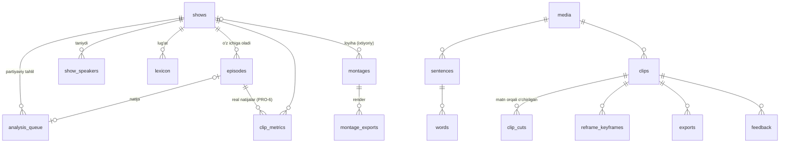

# Ma'lumot modeli

Ikki SQLite baza (WAL rejimi). Sxemalar: `engine/src/lahza_engine/db/library.sql` va `project.sql`. Vaqt — butun son ms; matn — Unicode NFC, rasmiy imlo (ADR-0008).



## library.db (Kutubxona)

| Jadval | Maqsad |
| --- | --- |
| `shows` | Shou (loyiha) |
| `episodes` | Epizod: sarlavha, `project_dir`, holat (`new / analyzing / ready / failed`), `highlight_mode` (`llm / lite`, v2) |
| `show_speakers` | Shou darajasidagi spikerlar va ovoz embeddinglari (keyingi epizodlarda avtomatik tanish) |
| `lexicon` | `term`, `variants_json`, `kind` (`ism / brend / atama`), `show_id` (`NULL` — umumiy). Tahlilga `hotwords` (atamalar) va `lexicon_map` (variant → atama) bo'lib uzatiladi |
| `style_templates` | Brend shablonlari: `name`, `json` (StyleTemplate), `updated_at` (v2) |
| `settings` | Kalit-qiymat sozlamalar |
| `montages` | Montaj (v3): `project_id` (→ `shows`, `ON DELETE SET NULL`), `name`, `template_id`, `sources_json` (manbalar + `media_id`, `path`), `overrides_json`, `timeline_json` (`lahza.timeline/1`, reja tayyor bo'lguncha `NULL`), `duration_ms`, `status` (`planning / ready / failed`), `error`, `job_id` (oxirgi rejalashtirish vazifasi), `user_edited`, `created_at`, `updated_at` |
| `user_templates` | Foydalanuvchi video shablonlari (v3): `id` (`user.<uuid12>` yoki import qilingan id), `json` (`lahza.template/1`), `created_at`, `updated_at`. O'rnatilgan shablonlar bazada emas — `templates/builtin/*.json` |
| `montage_exports` | Montaj renderlari (v3): `montage_id` (`ON DELETE CASCADE`), `job_id`, `path`, `status` (`queued → running → done / failed / cancelled`), `error`, `created_at`, `finished_at` |
| `analysis_queue` | Partiyaviy tahlil navbati (v4, PRO-5): `show_id` (`ON DELETE CASCADE`), `episode_id` (ishga tushganda yaratiladi, `ON DELETE SET NULL`), `path`, `title`, `options_json` (`focus`, `num_speakers`, `force_lite`), `position` (tartib), `status` (`queued → running → done / failed / cancelled`), `error`, `job_id`, `created_at`, `started_at`, `finished_at`. Engine ishga tushganda `running` → `queued` |
| `personal_dictionary` | Shaxsiy lug'at (v5, PRO-1): `wrong` (kichik harf, 1..3 so'z), `right`, `kind` (`ism / atama / soz`), `count` (necha marta tuzatilgan), `last_episode_id`, `created_at`, `updated_at`; `UNIQUE(wrong, right)`. Umumiy (shouga bog'lanmagan). Faol yozuv: `count >= 2` va shu `wrong` uchun ulushi >= 80% (`text.personal_dict.resolve`) |
| `clip_metrics` | Klip real natijalari (v5, PRO-6): `episode_id` va `show_id` (`ON DELETE CASCADE`), `clip_id`, `views` (>= 0), `likes` (ixtiyoriy, >= 0), `features_json` (kiritish paytidagi `scores_json` dan `llm`, `signal`), `score`, `source`, `recorded_at`; `UNIQUE(episode_id, clip_id)` (+ `idx_clip_metrics_show`). Qayta kiritish yozuvni o'chirib yangidan yozadi (yangi `id`) |
| `highlight_weights` | O'rganilgan ball vaznlari (v5, PRO-6): `scope` (`global` yoki shou ID), `weights_json` (`{"weight_llm","weight_signals"}`; `NULL` — standart), `n_samples`, `since_id` (tiklashdan keyin faqat `clip_metrics.id > since_id` namunalar), `updated_at` |

## project.db (Epizod)

| Jadval | Muhim maydonlar | Izoh |
| --- | --- | --- |
| `media` | path, hash, duration_ms, fps, width, height | Asl fayl ko'chirilmaydi, faqat havola |
| `stage_runs` | stage, version, model_id, param_hash, cache_key, status, result_path | Kesh va qayta ishga tushirish |
| `sentences` | id, start_ms, end_ms, speaker_id, text | LLM shu ID'lar bilan ishlaydi (ADR-0005) |
| `words` | sentence_id, ord, text, start_ms, end_ms, confidence, edited, original_text | `edited = 1` qayta tahlilda saqlanadi. So'z o'chirilsa/bo'linsa gap so'zlari qayta yoziladi, `ord` 0..n-1 |
| `clips` | start/end, sentence ID'lar, title, caption, hashtags_json, kind, score, scores_json, reason, status, source, user_edited | `user_edited = 1` yoki `status != nomzod` qayta tahlilda saqlanadi |
| `clip_cuts` | start_ms, end_ms | Manba vaqtida |
| `speakers` | id (= label), label, display_name | Spiker yorlig'iga foydalanuvchi bergan ism |
| `reframe_keyframes` | t_ms (chiqish vaqti), layout, cx, cy, zoom, lane (a/b), source (`avto / qolda`) | API PUT barcha kalit kadrlarni `qolda` bilan almashtiradi; eksport `qolda` ni ustun qo'yadi |
| `exports` | path, profile_json, status, error, job_id (v2), finished_at (v2) | Har eksport so'rovi: `queued → running → done / failed / cancelled` |
| `feedback` | action (qabul/rad/tahrir), metrics_json | Ball vaznlarini o'rganish (Pro) |
| `corrections` | audio_chunk_path (`cache/audio16k.wav#<start>-<end>`), before_text, after_text, media_id (v2), sentence_id (v2) | So'z tahriri: gap matni oldin/keyin (ASR'ni yaxshilash, Pro) |

## Fayl tuzilmasi

```
Library/
  library.db
  _montage/<montaj_id>/
    cache/          manba tahlili keshi (montage.analyze, xesh bo'yicha JSON)
    work/           preview kadrlari va render ish papkalari (<job_id>/) - ishdan keyin o'chiriladi
    thumbs/         manba kichik kadrlari (<media_id>-<t_ms>.jpg)
  <Shou>/
    <Epizod>-<id>.lahza/
      project.db
      cache/          audio16k.wav, proxy.mp4, <bosqich>-<kalit>.json
      work/<clip>/    render ish papkasi (graph.txt, *.cmd, subs.ass) - render'dan keyin o'chiriladi
      thumbs/
```

## Migratsiya

`db/store.py`: ikki baza alohida versiyalanadi — `LIBRARY_SCHEMA_VERSION` + `LIBRARY_MIGRATIONS` va `PROJECT_SCHEMA_VERSION` + `PROJECT_MIGRATIONS` (`{versiya: SQL}`; `SCHEMA_VERSION`/`MIGRATIONS` — loyiha bazasi uchun orqaga moslik nomlari). Eski baza ochilganda avval SQLite backup API bilan `<baza>.v<N>.bak` (masalan `project.v1.bak`, `library.v1.bak`) zaxira nusxa olinadi (WAL'dagi yozuvlar ham kiradi), so'ng migratsiyalar ketma-ket qo'llanadi. Yangiroq versiyada yaratilgan baza ochilmaydi (aniq xabar). Hozirgi versiyalar: kutubxona — **v5**, loyiha — **v3**. Yangi bazalar `*.sql` dan to'g'ridan-to'g'ri oxirgi versiyada yaratiladi — `.sql` va migratsiya natijasi bir xil ustunlarga ega bo'lishi testda tekshiriladi.

### v2 (M2)

| Baza | O'zgarish |
| --- | --- |
| library | `episodes.highlight_mode` (`llm / lite`); `style_templates.updated_at`; `idx_lexicon_show` indeksi |
| project | `exports.job_id`, `exports.finished_at`; `corrections.media_id`, `corrections.sentence_id` |

### v3 (Montaj)

| Baza | O'zgarish |
| --- | --- |
| library | Yangi jadvallar: `montages` (+ `idx_montages_project`), `user_templates`, `montage_exports` (+ `idx_montage_exports_montage`). Zaxira — `library.v2.bak` |

### v4 (Partiyaviy tahlil)

| Baza | O'zgarish |
| --- | --- |
| library | Yangi jadval `analysis_queue` (+ `idx_analysis_queue_status`). Zaxira — `library.v3.bak` |

### v5 (Shaxsiy lug'at va ball vaznlari, PRO-1/PRO-6)

| Baza | O'zgarish |
| --- | --- |
| library | Yangi jadvallar: `personal_dictionary`, `clip_metrics` (+ `idx_clip_metrics_show`), `highlight_weights`. Zaxira — `library.v4.bak` |
