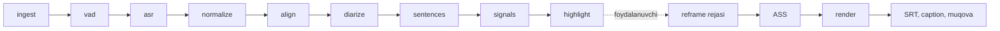

# Pipeline

Tahlil import qilingandan keyin avtomatik ishlaydi (`core/analyze.py`); eksport foydalanuvchi bosganda (`core/export.py`). Har bosqich — alohida, keshlanadigan, qayta ishga tushiriladigan vazifa.



| # | Bosqich | Kirish | Chiqish | Model | Zaxira |
| --- | --- | --- | --- | --- | --- |
| 1 | `ingest` | video yo'li | `media` qatori, `audio16k.wav`, `proxy.mp4` | — | proksi bo'lmasa ham davom etadi |
| 2 | `vad` | WAV | nutq oraliqlari | Silero | energiya VAD |
| 3 | `asr` | WAV + oraliqlar (≤ 30 s bo'laklar) | so'zlar | whisper.cpp / faster-whisper / ONNX | **yo'q — to'xtaydi** |
| 4 | `normalize` | so'zlar | imlo + lug'at | — | — |
| 5 | `align` | so'zlar + WAV | aniq so'z vaqtlari | CTC | ASR vaqtlari (usul qayd etiladi) |
| 6 | `diarize` | WAV + so'zlar | spiker yorliqlari | pyannote | spikersiz |
| 7 | `sentences` | so'zlar | gaplar → `project.db` | — | — |
| 8 | `signals` | gaplar + WAV | gap signallari | (kulgi detektori — R0) | — |
| 9 | `highlight` | gaplar + signallar | kliplar → `project.db` | llama-server | Lite rejim |

## Kesh kaliti

```
kalit = sha256( media_hash | bosqich | versiya | model_id | param_hash | yuqori_oqim_kalitlari... )
```

* `media_hash` — tez xesh: hajm + birinchi/oxirgi 64 MB (xxh3 bo'lsa, aks holda blake2b).
* Bosqich kodi o'zgarsa — `StageDef.version` oshiriladi.
* Natija: `cache/<bosqich>-<kalit[:12]>.json`, holat: `stage_runs`.
* Yuqori oqim kaliti kalitga kiradi: ASR modeli almashsa, `normalize` dan `highlight` gacha qayta hisoblanadi; faqat highlight parametri o'zgarsa — faqat highlight.

## Progress

Har bosqich `weight` ga ega (ASR — 10, highlight — 4, …). Umumiy progress = tugagan og'irliklar + joriy bosqich ulushi. Engine har yangilanishni WebSocket'ga yuboradi.

## Resurslar

Modellar ketma-ket yuklanadi va bo'shatiladi: ASR → alignment → diarizatsiya → LLM. `llama-server` faqat highlight bosqichida ishga tushadi va tugagach to'xtatiladi (`core/llama_server.py`). Og'ir vazifalar bitta oqimda; eksport alohida oqimlarda (`core/jobs.py`).

Partiyaviy tahlil (PRO-5, `core/batch.py`): bir nechta epizod `analysis_queue` jadvaliga qo'shiladi va navbat bittadan `analyze` vazifasini yuboradi — keyingisi oldingisi tugagach. Har element mavjud import oqimidan o'tadi (epizod yaratish + `submit_analysis`); bitta elementning xatosi qolganlarini to'xtatmaydi. Engine qayta ishga tushsa, `running` element `queued` ga qaytadi va o'sha epizod qayta tahlil qilinadi — kesh tufayli tugagan bosqichlar o'tkazib yuboriladi. CLI ekvivalenti: `lahza batch VIDEO... --out-dir D`.

## Eksport

1. `Timeline(start, end, cuts)` — manba ↔ chiqish vaqti xaritasi (`timeline.py`).
2. Reframe rejasi: yuz detektori bo'lsa — 5 fps kuzatuvlar → `reframe.plan`; bo'lmasa — xira fon.
3. ASS: klip so'zlari chiqish vaqtiga o'tkaziladi, o'chirilgan joydagi so'zlar tushib qoladi.
4. Render: `render/graph.py` — bo'laklar (kesim × layout) → concat → `ass` → audio fade (+ loudnorm, agar maqsad belgilangan bo'lsa) → enkoder.
5. Yonida: `.srt`, `_caption.txt` (sarlavha, matn, heshteglar — tanlangan imloda), `_cover.jpg`.
6. Fayl nomi: `{shou}_{epizod}_{nn}_{sarlavha}.mp4`.
