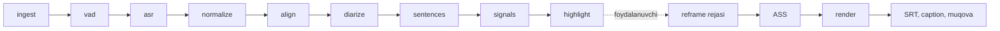

# Pipeline

Tahlil import qilingandan keyin avtomatik ishlaydi (`core/analyze.py`); eksport foydalanuvchi bosganda (`core/export.py`). Har bosqich — alohida, keshlanadigan, qayta ishga tushiriladigan vazifa.



| # | Bosqich | Kirish | Chiqish | Model | Zaxira |
| --- | --- | --- | --- | --- | --- |
| 1 | `ingest` | video yo'li | `media` qatori, `audio16k.wav`, `proxy.mp4` | — | proksi bo'lmasa ham davom etadi |
| 2 | `vad` | WAV | nutq oraliqlari | Silero | energiya VAD |
| 3 | `asr` | WAV + oraliqlar (≤ 30 s bo'laklar) | so'zlar | whisper.cpp / faster-whisper / ONNX | **yo'q — to'xtaydi** |
| 4 | `normalize` | so'zlar | imlo + lug'at | — | — |
| 5 | `align` | so'zlar + WAV | aniq so'z vaqtlari | CTC | ASR vaqtlari (usul qayd etiladi) |
| 6 | `diarize` | WAV + so'zlar | spiker yorliqlari | pyannote | spikersiz |
| 7 | `sentences` | so'zlar | gaplar → `project.db` | — | — |
| 8 | `signals` | gaplar + WAV | gap signallari | (kulgi detektori — R0) | — |
| 9 | `highlight` | gaplar + signallar | kliplar → `project.db` | llama-server | Lite rejim |

## Kesh kaliti

```
kalit = sha256( media_hash | bosqich | versiya | model_id | param_hash | yuqori_oqim_kalitlari... )
```

* `media_hash` — tez xesh: hajm + birinchi/oxirgi 64 MB (xxh3 bo'lsa, aks holda blake2b).
* Bosqich kodi o'zgarsa — `StageDef.version` oshiriladi.
* Natija: `cache/<bosqich>-<kalit[:12]>.json`, holat: `stage_runs`.
* Yuqori oqim kaliti kalitga kiradi: ASR modeli almashsa, `normalize` dan `highlight` gacha qayta hisoblanadi; faqat highlight parametri o'zgarsa — faqat highlight.

## Progress

Har bosqich `weight` ga ega (ASR — 10, highlight — 4, …). Umumiy progress = tugagan og'irliklar + joriy bosqich ulushi. Engine har yangilanishni WebSocket'ga yuboradi.

## Resurslar

Modellar ketma-ket yuklanadi va bo'shatiladi: ASR → alignment → diarizatsiya → LLM. `llama-server` faqat highlight bosqichida ishga tushadi va tugagach to'xtatiladi (`core/llama_server.py`). Og'ir vazifalar bitta oqimda; eksport alohida oqimlarda (`core/jobs.py`).

Partiyaviy tahlil (PRO-5, `core/batch.py`): bir nechta epizod `analysis_queue` jadvaliga qo'shiladi va navbat bittadan `analyze` vazifasini yuboradi — keyingisi oldingisi tugagach. Har element mavjud import oqimidan o'tadi (epizod yaratish + `submit_analysis`); bitta elementning xatosi qolganlarini to'xtatmaydi. Engine qayta ishga tushsa, `running` element `queued` ga qaytadi va o'sha epizod qayta tahlil qilinadi — kesh tufayli tugagan bosqichlar o'tkazib yuboriladi. CLI ekvivalenti: `lahza batch VIDEO... --out-dir D`.

## Eksport

1. `Timeline(start, end, cuts)` — manba ↔ chiqish vaqti xaritasi (`timeline.py`).
2. Reframe rejasi: yuz detektori bo'lsa — 5 fps kuzatuvlar → `reframe.plan`; bo'lmasa — xira fon.
3. ASS: klip so'zlari chiqish vaqtiga o'tkaziladi, o'chirilgan joydagi so'zlar tushib qoladi.
4. Render: `render/graph.py` — bo'laklar (kesim × layout) → concat → `ass` → audio fade (+ loudnorm, agar maqsad belgilangan bo'lsa) → enkoder.
5. Yonida: `.srt`, `_caption.txt` (sarlavha, matn, heshteglar — tanlangan imloda), `_cover.jpg`.
6. Fayl nomi: `{shou}_{epizod}_{nn}_{sarlavha}.mp4`.

### Aktiv spiker: ASD + diarizatsiya (R0-VIS-2, M3-RF-1)

* **ASD backend** — `reframe/asd.py`, LR-ASD ONNX (onnxruntime, CPU). Fayllar Task.VISION standart to'plami papkasidan (`vision-blazeface-lrasd`, hozircha `candidate`, sha256 noma'lum): uchta bo'lingan fayl (`asd_audio_frontend.onnx`, `asd_visual_frontend.onnx`, `asd_av_backend.onnx`) yoki bitta `asd.onnx`. Kirish: MFCC [1, 4T, 13] (16 kHz, 100 kadr/s, `python_speech_features` ga teng numpy hisob) va kulrang yuz kesimlari [1, T, 112, 112] (25 fps, `face_crop`). Chiqish [T, 2] (softmax) yoki [T] (logit/ehtimol) → 0..1. Uzun trek 250 kadrlik bo'laklarda baholanadi. `score_track` — trek bo'yicha (t_ms, ball); `scores_at` — 25 fps ballarni 5 fps kuzatuvga (±200 ms o'rtacha).
* **Fallback** — model fayli yo'q, onnxruntime yo'q yoki fayl buzuq: `load_asd_backend` xatosiz `None` qaytaradi; reframe hozirgi heuristikada ishlaydi (eng katta yuz).
* **Birlashma** — `reframe/active_speaker.py: resolve_active_speakers(obs, cfg, turns, overlaps)`. `Observation` da `track_ids` (treker ID) va `asd_scores` (trek → ehtimol) bo'lsa:
  1. har kuzatuvga diarizatsiya spikeri va ustma-ust belgisi;
  2. spiker ↔ trek xaritasi ASD ballarining birgalikda uchrashidan (`speaker_map.learn_speaker_to_track`);
  3. trek bali = `asd_weight`·ASD + (1−`asd_weight`)·[diarizatsiya kutgan trek];
  4. gisterezis: yangi yuz `speaker_switch_margin` ga ustun bo'lib `speaker_switch_confirm_ms` davom etsa va joriy yuz `speaker_min_hold_ms` ushlangan bo'lsa almashadi; joriy yuz kadrdan chiqsa yoki sahna kesilsa — darhol;
  5. nutq bor, lekin eng yaxshi bal `active_min_confidence` dan past holat `low_confidence_wide_ms` davom etsa — `wide=True` → layout FIT_BLUR (keng kadr). Sukunatda joriy yuz ushlanadi.
  
  ASD ballari bo'lmasa — eng katta yuz, shu gisterezis bilan (o'lchami yaqin yuzlar orasida sakramaydi), keng kadrga o'tilmaydi. Natija `planner.plan` ga beriladi: kamera yo'li (o'lik zona, One-Euro, almashuvda keskin kesim) o'zgarmaydi.
* Barcha chegaralar `ReframeConfig` da "R0" deb belgilangan — Reframe-Eval to'plamida (aktiv spiker kadrda bo'lgan vaqt ulushi, keraksiz kamera harakatlari soni) tanlanadi.
* Hali ulanmagan: `core/export.py: observations_for_clip` 25 fps yuz kesimlari + audio bilan `score_track` ni chaqirishi va `resolve_active_speakers` ni `plan` dan oldin ishlatishi kerak (hozir eng katta yuz).
