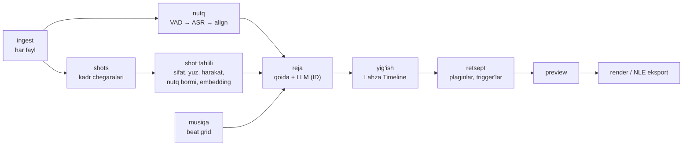
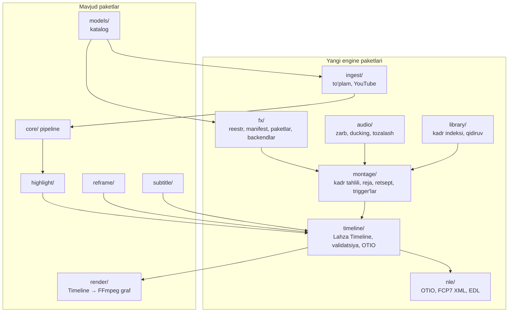

# 11 — Lahza Montaj: mavjud kadrlardan to'g'ri montaj (kengaytma TZ)

* Holat: **Qisman amalga oshirildi** (2026-10-20; taklif — 2026-10-18). Nima tayyorligi — [13-bo'lim](#13-yol-xaritasi), video shablonlar — [5.7](#57-video-shablon-retsept--tuzilma)
* Asos: [`00-TZ.md`](00-TZ.md), [`01-arxitektura.md`](01-arxitektura.md), [`02-yol-xaritasi.md`](02-yol-xaritasi.md)
* Yangi qarorlar: [ADR-0010](adr/0010-youtube-havola-import.md), [ADR-0011](adr/0011-deklarativ-plaginlar.md), [ADR-0012](adr/0012-lahza-timeline.md), [ADR-0013](adr/0013-haqiqiy-kadr-tamoyili.md)

> **Qisqasi.** Lahza "podkastdan Reels kesuvchi" dasturdan **mavjud kadrlarni to'g'ri montaj qiladigan studiyaga** kengayadi. Foydalanuvchi videolarni yuklaydi yoki YouTube havolasini beradi. Lahza ularni tushunadi: kim gapiryapti, qayer qiziq, qaysi kadr sifatli. So'ng plaginlar va retseptlar yordamida Reels, multicam epizod yoki to'plamdan ritmik rolik yig'adi. Higgsfield'dan farqli o'laroq, Lahza **yangi kadr yaratmaydi**: AI faqat tushunish va qaror qilish uchun ishlatiladi, piksellar esa doim foydalanuvchining o'z videosidan olinadi.

---

## Mundarija

0. [Talablar va talqin](#0-talablar-va-talqin)
1. [Asosiy tamoyil: haqiqiy kadr](#1-asosiy-tamoyil-haqiqiy-kadr)
2. [Foydalanuvchilar va stsenariylar](#2-foydalanuvchilar-va-stsenariylar)
3. [Kirish: fayl, papka, YouTube havola](#3-kirish-fayl-papka-youtube-havola)
4. [Reels oqimi](#4-reels-oqimi)
5. [Plaginlar tizimi (Lahza FX)](#5-plaginlar-tizimi-lahza-fx)
6. [Avtomontaj: video to'plamidan montaj](#6-avtomontaj-video-toplamidan-montaj)
7. [Montaj dasturlari bilan ko'prik: AE, DaVinci, Premiere, Filmora](#7-montaj-dasturlari-bilan-koprik-ae-davinci-premiere-filmora)
8. [Higgsfield'dan olinadigan namunalar](#8-higgsfielddan-olinadigan-namunalar)
9. [Qo'shimcha yangi imkoniyatlar](#9-qoshimcha-yangi-imkoniyatlar)
10. [Arxitektura](#10-arxitektura)
11. [Sifat, xavfsizlik va litsenziya talablari](#11-sifat-xavfsizlik-va-litsenziya-talablari)
12. [Huquqiy jihatlar](#12-huquqiy-jihatlar)
13. [Yo'l xaritasi](#13-yol-xaritasi)
14. [Ochiq savollar](#14-ochiq-savollar)
15. [Manbalar](#15-manbalar)

---

## 0. Talablar va talqin

| # | Talab | Hujjatdagi javob |
| --- | --- | --- |
| 1 | Videolarni yuklash yoki YouTube havolasini berish orqali Instagram Reels yasaydigan servis | [3](#3-kirish-fayl-papka-youtube-havola), [4](#4-reels-oqimi) |
| 2 | AE, DaVinci, Premiere Pro, Filmora'da montaj uchun ishlatiladigan narsalar — plaginlar; berilgan videolar to'plamini bir nechta plagin asosida montaj qiladigan bo'lim | [5](#5-plaginlar-tizimi-lahza-fx), [6](#6-avtomontaj-video-toplamidan-montaj), [7](#7-montaj-dasturlari-bilan-koprik-ae-davinci-premiere-filmora) |
| 3 | Higgsfield'dan namunalar olish; farqi — yo'q narsani bor qilish emas, mavjud kadrlarni montaj qilish | [8](#8-higgsfielddan-olinadigan-namunalar) |
| 4 | Servisning asosiy maqsadi — bor kadrlardan foydalanib to'g'ri montaj qilish | [1](#1-asosiy-tamoyil-haqiqiy-kadr) |
| + | Qo'shimcha yangi narsalar | [9](#9-qoshimcha-yangi-imkoniyatlar) |

**Qabul qilingan talqin** (o'zgarsa, shu bo'lim va ADR'lar yangilanadi):

* **"Servis" — Lahza Studio desktop dasturi ichidagi yangi xizmat (modul).** Dastur avvalgidek macOS (Apple Silicon) va Windows uchun, hisob-kitob kompyuterda bajariladi, videolar hech qayerga yuborilmaydi. Yagona yangi tarmoq amali — foydalanuvchi o'zi bergan YouTube havolasidan videoni yuklab olish. U faqat foydalanuvchi tugmani bosganda ishlaydi ([ADR-0010](adr/0010-youtube-havola-import.md)). Veb-servis (SaaS) varianti — [14-bo'lim](#14-ochiq-savollar)dagi ochiq savol.
* **"Plaginlar" ikki ma'noda olindi:**
  * **(a) Lahza ichidagi montaj plaginlari:** o'tishlar, kamera harakatlari, rang (LUT), matn animatsiyalari, audio effektlari. Bular AE, DaVinci, Premiere va Filmora montajchilari kundalik ishlatadigan narsalarning Lahza'dagi muqobili. Retsept bir nechta plaginni birlashtirib, video to'plamini avtomatik montaj qiladi.
  * **(b) Shu dasturlar bilan ko'prik:** Lahza montajini ularda loyiha sifatida ochish va ularning formatidagi aktivlarni (LUT, Lottie) Lahza'ga olish.

---

## 1. Asosiy tamoyil: haqiqiy kadr

[ADR-0013](adr/0013-haqiqiy-kadr-tamoyili.md). Lahza chiqargan har bir kadr ikki manbadan biridan olinadi:

* foydalanuvchi bergan videoning **deterministik o'zgartirilgani** (kesish, kattalashtirish, ranglash, aralashtirish);
* **grafik qatlam** — matn, subtitr, logo, shakl yoki foydalanuvchi bergan rasm.

Hech bir model yangi tasvir, odam, obyekt, harakat yoki ovoz "o'ylab topmaydi".

**AI qayerda ishlaydi:** tushunish va qaror qilishda. Masalan, nutqni matnga aylantirish, kim gapirayotganini aniqlash, eng qiziq lahzani tanlash, kadrlarni tasniflash, effektni qayerga qo'yishni hal qilish. Piksellarni yaratishda AI ishlatilmaydi.

| Toifa | Misollar | Holat |
| --- | --- | --- |
| Kesish va tartib | kesish, o'chirish, joy almashtirish, J/L-kesim | Ruxsat |
| Vaqt | tezlashtirish, sekinlashtirish (kadr takrorlash yoki tashlash), freeze-frame, teskari | Ruxsat |
| Raqamli kamera | crop, zoom, pan, aylantirish, silkinish — hammasi manba kadri ichida | Ruxsat |
| Rang | LUT, ekspozitsiya, oq balans, kameralarni bir-biriga moslash | Ruxsat |
| Kompozitsiya | split-screen, o'sha kadrdan xira fon, PiP, maska | Ruxsat |
| O'tishlar | ikki mavjud kadr aralashmasi (dissolve, whip, zoom) | Ruxsat |
| Grafika | subtitr, sarlavha, logo, shakl, stiker, progress bar — foydalanuvchi yoki litsenziyali aktiv | Ruxsat |
| Audio | shovqin tozalash, loudness, EQ, foydalanuvchi bergan musiqa, ducking | Ruxsat |
| Oraliq kadr sintezi | optik oqim bilan silliq slow-motion | **Ehtiyotkor:** standart holatda o'chiq; yoqilsa, eksport hisobotida belgilanadi |
| Super-resolution | past sifatli kadrni "tiniqlashtirish" | v2 gacha yo'q; keyin ham ehtiyotkor toifada |
| Generatsiya | matndan yoki rasmdan video, outpainting (9:16 ga yetmagan joyni chizish), yuz almashtirish, lab-sinxron, ovoz klonlash, yangi odam yoki obyekt | **Taqiq** |

Bu tamoyilning ikki amaliy natijasi bor:

* **Montaj hisoboti.** Har eksport yonida `<nom>_edl.json` fayli bo'ladi: qaysi manba, qaysi oraliq, qaysi effektlar ishlatilgani yoziladi. Shu orqali har bir kadrni manbasigacha kuzatish mumkin. Kadr ichiga generativ qism qo'shilmagani mahsulotning ishonch kafolati bo'ladi.
* **9:16 ga moslash faqat mavjud piksellar bilan.** Bunga focus crop, split yoki o'sha kadrdan olingan xira fon kiradi (mavjud `reframe/`). Yetishmagan joy hech qachon "chizilmaydi".

---

## 2. Foydalanuvchilar va stsenariylar

| Kim | Nima beradi | Nima oladi |
| --- | --- | --- |
| Podkast egasi | 1–3 kamerali epizod yoki YouTube havolasi | 5–10 ta Reels va to'liq epizodning avtomatik multicam montaji |
| SMM mutaxassisi | Mijozning video to'plami, brend shabloni | Bir uslubdagi Reels seriyasi, caption va muqova |
| Montajchi | Xom kadrlar | Lahza'da qo'pol montaj, so'ng Premiere/DaVinci'da yakuniy ishlov |
| Tadbir yoki biznes | Tadbir kadrlari to'plami va musiqa | Musiqa ritmiga yig'ilgan rolik |

| ID | Stsenariy | Bosqich |
| --- | --- | --- |
| S1 | YouTube havolasi → epizod tahlili → Reels galereyasi → eksport | M3 |
| S2 | 3 kamerali podkast → audio bo'yicha sinxron → spikerga qarab kamera almashadi → 16:9 epizod + 9:16 Reels | v1.5 |
| S3 | Kliplarga retsept qo'llash (masalan, "Podkast — kuchli hook"): kesimlarda zoom, kalit so'zda punch-in, oxirida brend kartasi | v1.5 |
| S4 | 40 ta tadbir videosi + musiqa → 45 s ritmik rolik, 3 variantda | v2.0 |
| S5 | Lahza montaji → `.otio` / `.xml` → DaVinci, Premiere yoki Filmora'da ochish, rang va ovozni yakunlash | M3 / v1.5 |
| S6 | O'z arxividan matn bilan B-roll qidirish ("choy ichayotgan odam", "shahar manzarasi") va topilgan kadrni nutq ustiga qo'yish | v2.0 |

---

## 3. Kirish: fayl, papka, YouTube havola

### 3.1 Fayl, papka, to'plam

* **Yuklash usullari:** fayllarni sudrab tashlash, papka tanlash yoki kuzatiladigan papka ([9-bo'lim](#9-qoshimcha-yangi-imkoniyatlar)).
* **To'plam (collection)** — bitta montaj uchun berilgan videolar guruhi: bir epizodning bir nechta kamerasi yoki tadbir kadrlari. Har bir fayl hozirgi `ingest` bosqichidan o'tadi: ffprobe, xesh, proksi.
* **Kameralar guruhini aniqlash:** fayllar davomiyligi va audio o'xshashligi bo'yicha guruh taklif qilinadi; foydalanuvchi tasdiqlaydi.

### 3.2 YouTube havola

[ADR-0010](adr/0010-youtube-havola-import.md). Oqim:

1. Foydalanuvchi havolani kiritadi (video, playlist yoki o'z kanali).
2. Lahza ogohlantiradi: faqat o'zingizga tegishli yoki egasidan ruxsat olingan videolarni yuklang ([12-bo'lim](#12-huquqiy-jihatlar)).
3. Lahza videoni yuklab oladi. Yuklab olish uzilsa, davom ettiriladi; tarmoq faqat shu amal davomida ishlatiladi.
4. Fayl oddiy import kabi pipeline'ga tushadi. Tarmoq shundan keyin boshqa ishlatilmaydi.

**Texnik asos.** Barcha faktlar tekshirilgan, manbalari havolada.

* **yt-dlp litsenziyasi.** Git repozitoriysi va PyPI paketi Unlicense ostida. Lekin rasmiy PyInstaller exe fayllarida GPLv3+ kod bor ([yt-dlp](https://github.com/yt-dlp/yt-dlp)). Shuning uchun Lahza exe'ni emas, PyPI paketini Python kutubxonasi sifatida ishlatadi (`from yt_dlp import YoutubeDL`, README'dagi "EMBEDDING YT-DLP" bo'limi).
* **JavaScript runtime talabi.** 2025.11.12 versiyasidan boshlab YouTube'ni to'liq qo'llash uchun `yt-dlp-ejs` va JavaScript runtime kerak. Tavsiya etilgani va standart holatda yoqilgan yagonasi — Deno, kamida 2.3.0 versiya. Runtime bo'lmasa, formatlar tanlovi "keskin cheklanadi" ([issue #15012](https://github.com/yt-dlp/yt-dlp/issues/15012), [EJS wiki](https://github.com/yt-dlp/yt-dlp/wiki/EJS)). Deno MIT litsenziyali ([deno](https://github.com/denoland/deno)).
* **Natija:** `yt-dlp` + `yt-dlp-ejs` + Deno ilovaga (sidecar'ga) qo'shilmaydi. Ular **komponent** sifatida ilovaning o'zidan — Sozlamalar yoki import kartasidagi tugma bilan, foydalanuvchi roziligi bilan — bir marta yuklanadi: boshlang'ich versiya, hajm va sha256 `media/youtube_components.py` da mahkamlangan, joylash atomik. Shuning uchun o'rnatuvchi hajmi oshmaydi.

**Videoni olish yo'llari, tavsiya tartibida:**

| # | Yo'l | Sifat | Huquqiy holat |
| --- | --- | --- | --- |
| 1 | Kompyuterdagi asl montaj fayli | Eng yuqori | Muammo yo'q |
| 2 | YouTube Studio → Content → video menyusi → Download | 720p yoki 360p (video hajmiga qarab); 24 soatda 5 martagacha; strike bo'lsa bloklanadi ([Google yordam](https://support.google.com/youtube/answer/56100)) | YouTube'ning rasmiy yo'li |
| 3 | Google Takeout — barcha yuklangan videolar eksporti ([Google yordam](https://support.google.com/youtube/answer/56100)) | Manbada ko'rsatilmagan | Rasmiy yo'l |
| 4 | Lahza'ga havola berish (yt-dlp) | Mavjud eng yaxshi format | YouTube shartlariga zid bo'lishi mumkin ([12-bo'lim](#12-huquqiy-jihatlar)) |

Lahza'da 2- va 3-yo'l uchun ichki yo'riqnoma bo'ladi. Ular orqali olingan fayl 1-yo'l kabi import qilinadi.

**Metama'lumot:** sarlavha va tavsif epizod kartasiga yoziladi. Agar videoda YouTube boblari (chapters) bo'lsa, ular highlight uchun qo'shimcha signal bo'ladi. Subtitr uchun Lahza o'z ASR'idan foydalanadi, chunki karaoke va kesim so'z darajasidagi aniq vaqtni talab qiladi.

**Yangilanish:** YouTube bilan ishlaydigan vosita tez-tez yangilanib turishi kerak. Shuning uchun u ilovaga qotirib qo'yilmaydi va ilova relizisiz yangilanadi: Sozlamalardagi "Yangilanishni tekshirish" asl manbalardan (PyPI JSON API, GitHub releases API) oxirgi yt-dlp, yt-dlp-ejs va Deno 2.x ni e'lon qilingan sha256 bilan oladi; qat'iy xost/paket ro'yxati, versiya pasaymaydi. Dastlab rejalangan imzolangan model katalogi ([ADR-0002](adr/0002-oflayn-model-katalogi.md)) orqali yangilash ishlatilmaydi — sababi [ADR-0010](adr/0010-youtube-havola-import.md) "Yangilanish" bo'limida.

---

## 4. Reels oqimi

Mavjud oqim saqlanadi va kengayadi: tahlil → highlight → reframe → subtitr → eksport ([`00-TZ.md`](00-TZ.md) 4–10-bo'limlar). Yangilari:

* Klip endi ichki **Lahza Timeline** sifatida saqlanadi ([10.2](#102-lahza-timeline-yagona-montaj-modeli)). Shu sababli klipga plagin, o'tish va retsept qo'llash mumkin bo'ladi.
* **Retsept tanlash:** galereyada barcha kliplarga bitta retsept qo'llanadi ([5.6](#56-retsept-bir-nechta-plagin-bitta-montaj-uslubi)).
* **Variantlar:** bitta klipdan 2–3 xil hook, sarlavha yoki retsept bilan variant chiqariladi ([9-bo'lim](#9-qoshimcha-yangi-imkoniyatlar)).
* **Montaj dasturiga eksport:** klipni MP4 bilan birga montaj dasturi loyihasi sifatida ham eksport qilish mumkin ([7-bo'lim](#7-montaj-dasturlari-bilan-koprik-ae-davinci-premiere-filmora)).

---

## 5. Plaginlar tizimi (Lahza FX)

[ADR-0011](adr/0011-deklarativ-plaginlar.md).

### 5.1 Plagin turlari

AE, DaVinci, Premiere va Filmora'da montajchilar eng ko'p ishlatadigan effekt guruhlari Lahza'da quyidagicha bo'ladi:

| Tur | Montajchilar nimani ishlatadi | Lahza'dagi misol | Backend |
| --- | --- | --- | --- |
| `transition` | Cross dissolve, whip pan, zoom o'tish, glitch | Keskin zoom o'tishi, whip, dip-to-black | FFmpeg `xfade` |
| `motion` | Keyframe bilan scale/position, punch-in, Ken Burns, camera shake | Punch-in kalit so'zda, sekin push-in, silkinish | `crop`/`scale` + `sendcmd` ([ADR-0009](adr/0009-sendcmd-dinamik-crop.md)) |
| `color` | LUT, Lumetri / Color page, kameralarni moslash | `.cube` LUT, iliq/sovuq preset, kamera moslash | FFmpeg `lut3d`, `colorbalance`, `curves` (`eq` GPL bo'lgani uchun ishlatilmaydi, [11.3](#113-komponentlar-va-litsenziyalar)) |
| `text` | Animatsiyali sarlavha, lower-third, MOGRT, AE matn presetlari | Sarlavha, spiker nomi plashkasi, hook matni, CTA | ASS ([ADR-0007](adr/0007-ass-yagona-manba.md)) yoki Lottie |
| `overlay` | Stikerlar, strelka, aylana, progress bar, logo | Progress bar, logo, emoji-stiker, ramka | FFmpeg `overlay` + PNG/Lottie |
| `layout` | Split-screen, PiP, blur fon | Focus, split, xira fon, PiP | Mavjud `reframe/` |
| `audio` | Denoise, EQ, kompressor, ducking, whoosh/hit SFX | Ovoz tozalash, musiqa ducking, whoosh o'tishda | FFmpeg audio filtrlari |
| `speed` | Speed ramp, freeze-frame | Ramp, freeze + zoom | `setpts`, `tpad`, `trim` |

### 5.2 Plagin — kod emas, ma'lumot

Plagin paketi faqat ma'lumotdan iborat bo'ladi: manifest (JSON) va resurslar (LUT, Lottie JSON, PNG, WebM preview, SFX audio). Paket ichida bajariladigan fayl, skript yoki kutubxona bo'lmaydi.

Bu mavjud xavfsizlik siyosatining davomi: `models/store.py` ham bajariladigan fayllarni rad etadi. Plagin effektni **tavsiflaydi**, uni engine'ning o'z kompilyatori FFmpeg grafiga aylantiradi.

**Manifest misoli** (qiymatlar misol uchun; standart qiymatlar M-bosqichda montajchilar bilan tanlanadi):

```json
{
  "schema": "lahza.fx/1",
  "id": "uz.lahza.motion.punch-in",
  "version": "1.0.0",
  "tur": "motion",
  "nomi": { "uz": "Punch-in", "uz-Cyrl": "Панч-ин", "ru": "Наезд", "en": "Punch-in" },
  "tavsif": { "uz": "Kalit so'zda kadrga keskin yaqinlashish" },
  "backend": "motion-keys",
  "params": [
    { "id": "zoom", "type": "float", "min": 1.0, "max": 2.0, "default": 1.25 },
    { "id": "kirish_ms", "type": "int", "min": 0, "max": 1000, "default": 120 },
    { "id": "easing", "type": "enum", "values": ["linear", "ease-out", "expo-out"], "default": "ease-out" },
    { "id": "markaz", "type": "enum", "values": ["yuz", "markaz", "kalit-kadr"], "default": "yuz" }
  ],
  "talab": { "manba_min_balandlik_px": null },
  "trigger_standart": "on_emphasis",
  "preview": "preview.webm",
  "litsenziya": "Lahza"
}
```

`manba_min_balandlik_px` qiymati sifat sinovida aniqlanadi. Raqamli zoom manbaning o'lchamidan oshib ketsa, kadr xiralashadi; Lahza buni ogohlantiradi.

### 5.3 Backendlar

| Backend | Nima qiladi | Bosqich |
| --- | --- | --- |
| `motion-keys` | Kalit kadrlar (zoom, cx, cy, burchak) → mavjud `crop@`/`scale` + `sendcmd` | v1.5 |
| `xfade` | FFmpeg'ning 58 ta nomli o'tishi va `custom` ifodalari | v1.5 |
| `lut` | `.cube` → `lut3d` | v1.5 |
| `ass-text` | ASS uslubi va animatsiya teglari (subtitr bilan bir xil yo'l) | v1.5 |
| `lottie` | Lottie JSON → shaffof kadrlar → `overlay` | v2.0 |
| `audio-graph` | Oq ro'yxatdagi audio filtrlar zanjiri | v1.5 |
| `glsl` | GLSL o'tishlar (gl-transitions formati, 125 ta, asosan MIT) | Keyin; GPU qatlami tanlanishi kerak ([14](#14-ochiq-savollar)) |

**FFmpeg filtrlari oq ro'yxati.** Manifestda faqat ruxsat etilgan filtrlar va parametrlar bo'lishi mumkin. Fayl o'qiydigan yoki tashqi manbaga murojaat qiladigan filtrlar (`movie`, `amovie` va shunga o'xshashlar), mutlaq yo'llar va shell kabi konstruksiyalar rad etiladi. Grafni har doim engine yig'adi; foydalanuvchi matni grafga to'g'ridan-to'g'ri kirmaydi ([`01-arxitektura.md`](01-arxitektura.md) xavfsizlik chegaralari).

### 5.4 Paketlar va imzo

* **Paket fayli `.lzfx`:** ichida manifestlar, resurslar va `SHA256SUMS` bo'lgan zip.
* **Rasmiy paketlar** katalog kaliti bilan imzolanadi (Ed25519, xuddi `catalog.json` kabi) va katalog orqali yuklanadi.
* **Foydalanuvchi o'zi qo'shgan paket** imzosiz ham qabul qilinadi, lekin "tekshirilmagan" deb belgilanadi. U baribir JSON sxema, oq ro'yxat, hajm chegarasi va zip-slip himoyasidan o'tadi; buning uchun mavjud `.lzpack` kodi qayta ishlatiladi.
* **Foydalanuvchining o'z aktivlari:** LUT (`.cube`), logo, PNG stiker, Lottie, SFX. Ular kutubxonaga import qilinadi, to'g'ridan-to'g'ri plagin sifatida ishlatiladi va brend kitga qo'shiladi.

### 5.5 Trigger'lar: effekt qayerga qo'yiladi

Montajchi effekt **qayerga** qo'yilishini o'zi hal qiladi. Lahza buni trigger'lar bilan avtomatlashtiradi:

| Trigger | Qachon ishlaydi | Manba |
| --- | --- | --- |
| `on_cut` | Har kesimda (matn orqali kesim, sukut kesimi) | `clip_cuts`, Timeline |
| `on_speaker_change` | Spiker almashganda | diarizatsiya |
| `on_emphasis` | Kalit so'z, raqam, savol, LLM belgilagan "zarb" gap | `highlight/signals.py`, LLM |
| `on_beat` | Musiqa zarbida (har N zarbda) | audio tahlil ([9](#9-qoshimcha-yangi-imkoniyatlar)) |
| `on_scene` | Sahna (kadr) almashganda | `media/scenes.py` |
| `on_start` / `on_end` | Klip boshi yoki oxiri | Timeline |
| `manual` | Foydalanuvchi qo'ygan nuqta | UI |

Har trigger'da cheklovlar bor: minimal oraliq, bitta klipdagi maksimal soni, qo'shni effekt bilan to'qnashmaslik. Bu qiymatlar retseptda beriladi va UzMontaj-Eval sinovida sozlanadi ([11.4](#114-sifat-baholash-uzmontaj-eval)).

### 5.6 Retsept: bir nechta plagin, bitta montaj uslubi

Retsept bir nechta plagin va trigger'ni bitta "uslub"ga birlashtiradi. Higgsfield'dagi bir bosishli preset g'oyasi shu yerda amalga oshadi, lekin real kadrlar ustida ([8](#8-higgsfielddan-olinadigan-namunalar)).

```json
{
  "schema": "lahza.recipe/1",
  "id": "uz.lahza.recipe.podcast-hook",
  "nomi": { "uz": "Podkast — kuchli hook" },
  "kirish": { "tur": "clip" },
  "qadamlar": [
    { "op": "hook_first" },
    { "op": "remove_fillers" },
    { "op": "remove_silence" },
    { "op": "reframe", "layout": "auto" },
    { "op": "fx", "plugin": "uz.lahza.motion.punch-in", "trigger": "on_emphasis" },
    { "op": "fx", "plugin": "uz.lahza.tr.zoom-cut", "trigger": "on_cut" },
    { "op": "captions", "style": "karaoke-bold" },
    { "op": "fx", "plugin": "uz.lahza.audio.whoosh", "trigger": "on_cut" },
    { "op": "end_card", "brand": true }
  ]
}
```

Retsept qadamlari Timeline ustidagi deterministik amallar. Bitta kirishga bitta retsept har doim bir xil natija beradi. Natija tayyor bo'lgach, foydalanuvchi uni tahrirlaydi, va tahrirlari qayta tahlilda saqlanadi (mavjud `user_edited` qoidasi).

### 5.7 Video shablon: retsept + tuzilma

**Amalga oshirilgan (2026-10-20).** Foydalanuvchiga ko'rinadigan atama — **video shablon**. Video shablon — bu [5.6](#56-retsept-bir-nechta-plagin-bitta-montaj-uslubi) dagi retsept g'oyasi va montaj **tuzilmasi** birgalikda:

* **retsept qismi** — qaysi plagin qayerda qo'llanadi: kliplar orasidagi o'tish, harakat effektlari va ularning trigger'lari (`fx`: `plugin`, `trigger`, `params`, `max_count`, `min_gap_ms`), rang (`color`), subtitr uslubi, musiqa va ducking, balandlikni me'yorlash;
* **tuzilma qismi** — montaj qanday yig'iladi: format (`aspect`), maqsad davomiylik, kadr uzunligi chegaralari, kadrlarni tanlash (`selection`: `highlight / scenes / full`), tartib (`order`: `berilgan / xronologik / ball`), bitta manbadan nechta kadr (`max_per_source`), intro / hook / outro kartalari, logotip.

Sxema — `lahza.template/1` (`engine/src/lahza_engine/templates/model.py`); u rejadagi `lahza.recipe/1` o'rnini egallaydi. Shablon ham plagin kabi faqat ma'lumot ([ADR-0011](adr/0011-deklarativ-plaginlar.md)): ichidagi har plagin id'si fx reestri bo'yicha tekshiriladi. Rejalashtiruvchi (`montage/planner.py`) shablon + foydalanuvchi tanlagan videolarni deterministik ravishda `lahza.timeline/1` ga aylantiradi ([10.2](#102-lahza-timeline-yagona-montaj-modeli)); render shu timeline'dan qilinadi.

O'rnatilgan 6 shablon (`templates/builtin/`, 4 tilda): `podcast-hook`, `event-rhythm`, `product-promo`, `interview-clean`, `course-announce`, `daily-story`. Foydalanuvchi shablonlari `library.db` dagi `user_templates` jadvalida; nusxa olish, import va eksport (`.json`) mumkin.

Karta matnida o'rinbosarlar ishlatiladi: `{sarlavha}`, `{shou}`, `{cta}`. Standart qiymat ikki nuqtadan keyin yoziladi: `{cta:Obuna bo'ling!}` — montajda CTA matni berilmasa shu matn chiqadi. Natija bo'sh bo'lsa karta qo'yilmaydi.

Namuna — `templates/builtin/product-promo.json` (qisqartirilgan: `name` va `description` faqat `uz` tilida; qolgan maydonlar fayldagidek):

```json
{
  "schema": "lahza.template/1",
  "id": "uz.lahza.tpl.product-promo",
  "version": "1.0.0",
  "name": {
    "uz": "Mahsulot — promo"
  },
  "description": {
    "uz": "Mahsulot yoki xizmat uchun 15-20 soniyalik promo: sarlavha kartasi, yorqin ranglar, tez kadrlar va oxirida harakatga chaqiruv kartasi."
  },
  "category": "mahsulot",
  "builtin": true,
  "aspect": "9:16",
  "fps": 30.0,
  "target_duration_ms": 18000,
  "min_shot_ms": 1500,
  "max_shot_ms": 3500,
  "selection": "scenes",
  "order": "ball",
  "max_per_source": 3,
  "respect_sentences": true,
  "reframe": "auto",
  "transition": {"plugin": "uz.lahza.tr.zoomin", "dur_ms": 250},
  "fx": [
    {
      "plugin": "uz.lahza.motion.punch-in",
      "trigger": "every_n",
      "every_n": 3,
      "params": {
        "zoom": 1.15,
        "kirish_ms": 150
      },
      "max_count": 3,
      "min_gap_ms": 3000
    }
  ],
  "color": "uz.lahza.color.vivid",
  "captions": false,
  "intro": {
    "text": "{sarlavha}",
    "dur_ms": 1500,
    "kind": "card",
    "background": "#111111",
    "position": "middle",
    "animation": "pop"
  },
  "outro": {
    "text": "{cta:Hoziroq buyurtma bering}",
    "dur_ms": 2500,
    "kind": "card",
    "background": "#111111",
    "position": "middle",
    "animation": "fade"
  },
  "music": {"required": false, "gain_db": -10.0, "duck": true, "fade_in_ms": 300, "fade_out_ms": 1500},
  "source_gain_db": -6.0,
  "mute_sources": false,
  "loudnorm_lufs": -14.0,
  "logo": true
}
```

Bu shablon: 18 soniyalik 9:16 promo; sahnalardan eng yaxshi kadrlar (har manbadan ko'pi bilan 3 ta, 1,5–3,5 s), kadrlar orasida 250 ms `zoomin` o'tishi, har 3-kadrda punch-in (ko'pi bilan 3 marta), `vivid` rang, boshida `{sarlavha}` kartasi, oxirida CTA kartasi, musiqa nutq ustida pasaytiriladi, logotip qo'yiladi.

---

## 6. Avtomontaj: video to'plamidan montaj

### 6.1 Kirish va chiqish

| Kirish | Majburiy | Izoh |
| --- | --- | --- |
| Video to'plami | Ha | 1…N fayl yoki YouTube havolalari |
| Retsept | Ha (standart tanlanadi) | Montaj uslubi |
| Davomiylik va format | Ha | 9:16 / 1:1 / 16:9; sanalangan platforma profillari va tasdiqlangan cheklovlar `render/profiles.py` orqali; eski limits JSON compatibility uchun |
| Musiqa | Yo'q | Faqat foydalanuvchining o'z yoki litsenziyali fayli |
| Brief | Yo'q | Qisqa tavsif: "yangi kurs e'loni, energiyali, oxirida ro'yxatdan o'tish" |
| Brend kit | Yo'q | Logo, ranglar, shrift, end-card |

**Chiqish:** tahrirlanadigan Lahza Timeline, 1–3 variant, MP4 va xohishga ko'ra montaj dasturi loyihasi.

### 6.2 Pipeline

Har bir bosqich hozirgi kesh mexanizmidan foydalanadi (`core/runner.py`): parametr o'zgarsa, faqat undan keyingi bosqichlar qayta hisoblanadi.



* **Kadr tahlili:**
  * **sifat** — xiralik, ekspozitsiya, silkinish, kamera tebranishi. Sifati yomon kadr past ball oladi;
  * **mazmun** — yuzlar soni va o'lchami, harakat miqdori, nutq bor-yo'qligi;
  * **vizual embedding** — kadrlarni ma'no bo'yicha guruhlash va brief bilan solishtirish uchun.
* **Nutq:** gapiradigan kadrlar mavjud ASR pipeline'idan o'tadi. Shu tufayli gap o'rtasida kesilmaydi (mavjud chegara qoidalari).

### 6.3 Reja rejimlari

| Rejim | Asos | Qachon |
| --- | --- | --- |
| Nutq-yetakchi | Gapirayotgan odam asos bo'ladi; B-roll kadrlar nutq ustini qoplaydi | Intervyu, ekspert videosi, e'lon |
| Musiqa-yetakchi | Kadrlar zarb panjarasiga joylashadi | Tadbir, mahsulot, atmosfera |
| Brief-yetakchi | LLM brief bo'yicha kadr ID'larini tanlaydi va tartiblaydi | Reklama, kurs e'loni |
| Xronologik | Kadrlar yozilgan vaqti bo'yicha, eng yaxshilari tanlab olinadi | Kun yoki tadbir hikoyasi |

### 6.4 LLM qoidasi (ADR-0005 kengaytmasi)

LLM ham bu yerda vaqt qaytarmaydi. U kadr va gap **ID'lari**, tartib hamda sabab qaytaradi. Javob JSON sxema bilan cheklanadi. Kesimlarni gap chegarasiga, kadr chegarasiga va musiqa zarbiga **kod** yopishtiradi.

LLM bo'lmasa (Lite daraja), reja faqat qoidalar asosida tuziladi: sifat bali, xilma-xillik, zarb.

```json
{
  "reja": [
    { "shot_id": "s014", "rol": "hook", "sabab": "eng kuchli savol" },
    { "shot_id": "s003", "rol": "broll", "ustida": "g021" },
    { "shot_id": "s027", "rol": "cta" }
  ]
}
```

### 6.5 Deterministik montaj qoidalari

Quyidagi qoidalar to'g'ri montajni ta'minlaydi. Ularning raqamli qiymatlari UzMontaj-Eval'da sozlanadi.

* Kadrning minimal va maksimal uzunligi beriladi. Bir kadr ketma-ket ikki marta takrorlanmaydi.
* **Jump-cut'dan qochish:** bir xil kamera va o'xshash kadr ketma-ket kelsa, Lahza punch-in, B-roll yoki boshqa kamerani qo'yadi.
* **Ovoz uzluksizligi:** audio crossfade, J/L-kesim (ovoz rasmdan oldinroq yoki keyinroq o'tadi), musiqa ducking qo'llanadi.
* **Ritm:** kesimlar zarbga yopishadi; agar bu gapni bo'lib yuborsa, gap chegarasi ustun turadi.
* **Rang:** bir sahnadagi kameralar bir-biriga moslashtiriladi ([9](#9-qoshimcha-yangi-imkoniyatlar)).
* **Xavfsiz zona:** matn va grafika Instagram interfeysi ostida qolib ketmaydi (mavjud `subtitle/layout.py`).

---

## 7. Montaj dasturlari bilan ko'prik: AE, DaVinci, Premiere, Filmora

Lahza ichki **Lahza Timeline**ni montaj dasturlarining almashinuv formatlariga aylantirib beradi. Natijada ishni montajchi o'z dasturida davom ettiradi: rang, ovoz va murakkab grafika shu yerda qilinadi. Bu Lahza'ni montajchilar uchun raqobatchi emas, "birinchi qo'pol montaj" vositasiga aylantiradi.

**Qaysi dastur nimani ochadi** (tekshirilgan, 2026-10-18). Belgilar: ✅ — qabul qiladi; ◐ — qisman yoki cheklov bilan; ✕ — qabul qilmaydi; "—" — tasdiqlanmagan.

| Format | Premiere Pro | After Effects | DaVinci Resolve | Filmora |
| --- | --- | --- | --- | --- |
| FCP7 XML (`.xml`, xmeml) | ✅ [P1] | ◐ XML import bor, dialekti ko'rsatilmagan [A1] | ✅ [R1] | ✅ [F1] |
| FCPXML (`.fcpxml`) | ✕ — konvertor kerak [P2] | — | ✅ (21-versiya: "Final Cut Pro 12 FCPXML") [R2] | ◐ import oynasi qabul qiladi, ishlashi tushuntirilmagan [F1] |
| OpenTimelineIO (`.otio`) | ◐ faqat Beta'da [P3] | ✕ — rejada yo'q [P3] | ✅ 18.5 versiyadan [R3] | — |
| CMX 3600 EDL | ✅ [P1] | — | ✅ [R1] | — |
| AAF | ✅ [P1] | ◐ faqat import, faqat Windows [A1] | ✅ [R1] | — |
| SRT subtitr | ✅ [P1] | — | ✅ [R4] | ✅ [F2] |
| `.cube` LUT | ✅ [P4] | ✅ [A2] | ✅ [R5] | ✅ [F3] |
| Premiere loyihasi (`.prproj`) | ✅ | ✅ [A1] | — | — |

Xulosa:

* **Uchta dastur uchun umumiy format — FCP7 XML.** Premiere, Resolve va Filmora uni ochadi.
* **Resolve uchun eng to'liq yo'l — OTIO**, u buni o'zi qo'llaydi.
* **After Effects** Lahza'dan to'g'ridan-to'g'ri timeline olmaydi. Uning yo'li Premiere orqali o'tadi: AE Premiere loyihasini import qiladi va ichma-ich sekvensiyalar kompozitsiya sifatida saqlanadi [A3].

**OpenTimelineIO** — ASWF repozitoriyasi, Apache-2.0, `pip install opentimelineio`; oxirgi reliz 0.18.1 (2025-11-09) [O1][O2].

* Yadroda faqat `.otio`, `.otioz`, `.otiod` formatlari qolgan. Qolgan adapterlar alohida: `OpenTimelineIO-Plugins` paketida AAF, `cmx_3600`, `fcp_xml` va boshqalar bor [O3].
* `otio-fcp-adapter` FCP7 XML'ni o'qiydi va yozadi [O4].
* `otio-fcpx-xml-adapter` FCPXML'ni o'qiydi va yozadi, lekin **o'tishlar, effektlar va rangni o'tkazmaydi** [O5].

### 7.1 Har dasturga nima beriladi

| Dastur | Lahza beradi | Qanday ochiladi | Nima o'tadi |
| --- | --- | --- | --- |
| **DaVinci Resolve** | `timeline.otio` (yoki `.otioz` — media bilan) [R1], zaxira sifatida `timeline.xml` | File → Import → Timeline | Kesimlar, treklar, audio; SRT — subtitr treki; LUT — fayl sifatida |
| **Premiere Pro** | `timeline.xml` (FCP7), `subs.srt` | File → Import | Kesimlar, treklar, audio, subtitr |
| **Filmora** | `timeline.xml` (FCP7), `subs.srt`, `luts/*.cube` | XML import, SRT import [F1][F2] | Kesimlar va treklar; effektlar — pishirilgan qatlam sifatida |
| **After Effects** | (1) Premiere orqali: XML → Premiere → AE import [A3]; (2) bitta klip uchun: MP4 + shaffof subtitr qatlami + `words.json` (so'z vaqtlari) | AE JSON faylni import qiladi [A1] | So'z vaqtlari bilan matn animatsiyasini AE'da yasash (ExtendScript skripti, [7.3](#73-panel-va-skriptlar-keyingi-bosqich)) |
| **Final Cut Pro** (qo'shimcha) | `timeline.fcpxml` | Import | Kesimlar; o'tish va effektlar o'tmaydi [O5] |

Har bir format uchun Lahza eksportdan oldin "nima o'tmaydi" ro'yxatini ko'rsatadi. Bu ro'yxat NLE-1 vazifasidagi qo'lda ochish matritsasi bilan tasdiqlanadi.

### 7.2 Aktivlar: dasturlardan Lahza'ga

| Aktiv | Qayerdan | Lahza'da | Holat |
| --- | --- | --- | --- |
| `.cube` LUT | To'rt dasturning hammasi ishlatadi [P4][A2][R5][F3] | `lut3d` .cube, .3dl, .dat, .m3d, .csp formatlarini o'qiydi ([11.3](#113-komponentlar-va-litsenziyalar)). Foydalanuvchining mavjud LUT to'plami to'g'ridan-to'g'ri ishlaydi | v1.5 |
| Lottie (Bodymovin JSON) | After Effects → Bodymovin kengaytmasi → JSON; lottie-web MIT [A4] | `lottie` backend (ThorVG). AE'da yasalgan animatsiyali sarlavha Lahza shabloniga aylanadi. AE'ning hamma imkoniyati Lottie'ga o'tmaydi; qo'llanadigan qism FX-6 da sinaladi | v2.0 |
| MOGRT | Premiere / AE | Adobe'dan tashqarida render qilish yo'li topilmadi (tasdiqlanmagan), Resolve uchun rasmiy ma'lumot yo'q [R6] | ✕; o'rniga Lottie |
| Fusion makrolari (`.setting`, `.drfx`) | DaVinci Resolve [R7] | Faqat Fusion ichida ishlaydi | ✕ |
| Filmora effekt paketlari | Filmstock "My Effects" [F4] | Fayl formati ochiq emas (tasdiqlanmagan) | ✕ |
| SFX, PNG, logo, shrift | Har qanday | Kutubxona va brend kit | v1.5 |

### 7.3 Panel va skriptlar (keyingi bosqich)

Fayl almashinuvi (7.1) **har qanday** versiyada ishlaydi. NLE-2 bosqichida qo'shimcha integratsiya qilinadi:

| Dastur | Imkoniyat | Lahza'da qo'llanishi | Cheklov |
| --- | --- | --- | --- |
| Premiere Pro | UXP panellar: 25.2 da public beta, 25.6 dan rasmiy [P5]. API fayl va sekvensiya import qila oladi [P6]. `ProjectConverter` OTIO va FCP XML eksport qiladi ("Since 26.2"), AAF — 26.3 [P7] | "Lahza" paneli: tanlangan sekvensiyani Lahza'ga yuborish (OTIO) va Lahza natijasini sekvensiya qilib qaytarish | 26.2 bo'yicha da'vo Adobe xodimi tomonidan bir marta qaytarib olingan [P8] — versiya sinovda tasdiqlanadi |
| After Effects | C++ SDK, skriptlar va dockable panellar [A5][A6]; AE uchun UXP hali beta [A7] | ExtendScript skripti: `words.json` dan so'z darajasida animatsiyali matn qatlamlari | — |
| DaVinci Resolve | OpenFX host; Lua va Python skriptlar [R8]; Workflow Integration plaginlari — Electron/JS, faqat Studio [R9]. 21.1 dan "advanced scripting" va Python — faqat Studio versiyasida [R10] | Studio uchun: Lahza natijasini timeline sifatida import qiluvchi skript. Bepul versiyada faqat File → Import | Bepul Resolve'da tashqi skript cheklangan |
| Filmora | OpenFX va VST3 plaginlarini qo'llaydi [F5]; ochiq SDK — tasdiqlanmagan | Faqat fayl almashinuvi | — |

**Pro bosqichi uchun g'oya.** Resolve [S1] ham, Filmora [F5] ham OpenFX host. Shuning uchun Lahza'ning ba'zi funksiyalari (masalan, karaoke subtitr yoki yuzga qarab reframe) OpenFX plagini sifatida ikkala dasturda ishlashi mumkin. Bu native C++ ish va alohida qaror talab qiladi.

### 7.4 Eksport paketi tarkibi

```
<shou>_<epizod>_<nn>_nle/
├── timeline.xml             # FCP7 XML — Premiere Pro, DaVinci Resolve, Filmora
├── timeline.otio            # OpenTimelineIO — DaVinci Resolve (asl model)
├── timeline.edl             # CMX 3600 — eng sodda zaxira (Premiere, Resolve)
├── timeline.fcpxml          # ixtiyoriy: Final Cut Pro
├── subs.srt                 # subtitr (tahrirlanadigan)
├── subs.ass                 # Lahza uslubidagi subtitr
├── words.json               # so'z vaqtlari (After Effects skripti uchun)
├── media/                   # ixtiyoriy: proksi yoki "collect files"
├── luts/                    # ishlatilgan .cube fayllar
└── README.txt               # qaysi dasturda qanday ochish
```

Effektlar ikki xil yo'l bilan uzatiladi:

* **Formatda ifodalanadiganlari** to'g'ridan-to'g'ri o'tadi: kesim, transform (zoom/pan), o'tish nomlari, tezlik, audio darajasi.
* **Ifodalanmaydiganlari** (Lottie, murakkab ASS animatsiya, plagin effektlari) **pishirilgan (rendered) qatlam** sifatida beriladi: shaffof `.mov` yoki PNG ketma-ketligi alohida trekda keladi. Pishirilgan qatlamlarning kodek va litsenziya masalasi M3'da tekshiriladi.

---

## 8. Higgsfield'dan olinadigan namunalar

**Higgsfield nima.** Higgsfield — generativ AI video va rasm platformasi. 2026-yil avgustida u 400 mln $ Series B investitsiya oldi, o'z ma'lumotiga ko'ra 30 mln dan ortiq foydalanuvchisi bor ([SiliconANGLE](https://siliconangle.com/2026/08/17/higgsfield-raises-400m-at-5-4-billion-valuation-to-scale-video-and-image-generation-platform/)). Asosiy ish usuli: kalit kadr rasmini yuklash yoki yaratish → preset tanlash → prompt yozish → **yangi video generatsiya qilish**; har generatsiya kredit sarflaydi ([DoP yo'riqnomasi](https://higgsfield.ai/creator-hub/help-center/ai-models/how-do-i-use-dop)).

UX jihatidan olinadigan narsalar:

* **Presetlar toifalari:** Effects, Basic Camera Control, Epic Camera Control, Catch the Pulse, shuningdek "New" va "Trending" lentalari. Har preset kartasida namuna video va "Generate" tugmasi bor ([camera-controls](https://higgsfield.ai/camera-controls), [DoP](https://higgsfield.ai/creator-hub/help-center/ai-models/how-do-i-use-dop)).
* **Mix:** 2 va undan ortiq kamera harakatini yoki effektni birlashtirish ([Mix](https://higgsfield.ai/blog/Introducing-Higgsfield-Mix-Motion-Reimagined), [Effects Mix](https://higgsfield.ai/blog/Higgsfield-Effects-Mix-Lets-You-Tell-Bigger-Stories)).
* **Apps katalogi** toifalar bo'yicha: Professional, Enhance & Style, Face & Identity, Video Editing, Ads & Products va boshqalar ([apps](https://higgsfield.ai/apps)). **Marketing Studio** shablon toifalari: Product shot, Motion, UGC, TikTok, Ads, Posters, Marketplace ([marketing-studio](https://higgsfield.ai/marketing-studio)).

Higgsfield'da mavjud videoni tahrirlash ham bor, lekin u **generativ**. AI Video Editor yuklangan klipni prompt orqali o'zgartiradi: uslub ko'chirish, obyektni olib tashlash yoki almashtirish, fonni almashtirish, Auto Reframe, upscale, dublyaj. Sahifada "Type to edit, no timeline" deyilgan; kesish, trim va subtitr tilga olinmagan ([ai-video-editor](https://higgsfield.ai/ai-video-editor)). Recast yuklangan videodagi personajni rasm bo'yicha almashtiradi ([recast](https://higgsfield.ai/apps/recast)).

Higgsfield'ning Lahza uchun muhim kamchiliklari:

* **Sifat barqarorligi.** Sinovlarda kesimlar orasida obyekt dizayni o'zgargan, yuz mos kelmagan ([SaaS CRM Review](https://saascrmreview.com/?p=13747)). Nomuvofiqliklar kreditni qayta generatsiyaga sarflashga majbur qiladi, bitta render 6–10 daqiqa davom etgan ([Hackceleration](https://hackceleration.com/labs/review/higgsfield)).
* **Kreditlar.** Kreditlar har davrda yonib ketadi ([SaaS CRM Review](https://saascrmreview.com/?p=13747)).
* **Ma'lumotlar.** Standart holatda foydalanuvchi kontenti model o'qitishda ishlatilishi mumkin, faqat Enterprise shartnomada bu istisno qilinadi ([Segmind](https://blog.segmind.com/higgsfield-credits-explained-expiry-rules-and-real-cost/)).

**Lahza'ning javobi:**

* timeline va matn (transkript) orqali montaj;
* faqat real kadr ([ADR-0013](adr/0013-haqiqiy-kadr-tamoyili.md)): bitta kirish har doim bir xil natija beradi, qayta generatsiya va kredit yo'q;
* video kompyuterdan chiqmaydi;
* o'zbek nutqi va imlosi.

### 8.1 Nima olinadi va nima olinmaydi

| Higgsfield'da | Lahza'da |
| --- | --- |
| Nomlangan presetlar galereyasi, har biri qisqa preview bilan | **Olinadi:** plagin va retseptlar galereyasi, har biri preview bilan, toifalar bo'yicha |
| Bir bosishda kino uslubidagi kamera harakati | **Olinadi:** shu harakatlarning raqamli ekvivalenti, real kadr ichida |
| Presetlarni birlashtirish | **Olinadi:** retsept = plaginlar + trigger'lar |
| Matn yoki rasmdan yangi video yaratish | **Olinmaydi:** [ADR-0013](adr/0013-haqiqiy-kadr-tamoyili.md) |
| Bulutda kredit evaziga generatsiya | **Olinmaydi:** hamma narsa kompyuterda, har montaj uchun to'lov yo'q |

### 8.2 Kamera harakatlari: real kadrdagi ekvivalenti

Kino atamalari umumiy tushunchalar. Lahza Higgsfield'ning nomlari, preview'lari yoki brendini ko'chirmaydi, faqat montajchilar biladigan umumiy atamalardan foydalanadi.

Higgsfield kamera presetlari ro'yxati [camera-controls](https://higgsfield.ai/camera-controls) sahifasidan, effektlar esa [effects](https://higgsfield.ai/effects) sahifasidan olindi. Holat belgilari:

* **✅** — real kadrda to'liq amalga oshadi;
* **◐** — yaqin ekvivalenti bor, lekin farqi bor (masalan, perspektiva o'zgarmaydi);
* **✕** — yangi nuqtai nazar yoki yangi piksel kerak, shuning uchun qilinmaydi.

| Higgsfield preseti | Lahza'dagi real kadr ekvivalenti | Holat | Qanday qilinadi |
| --- | --- | --- | --- |
| Zoom In / Zoom Out | Sekin zoom | ✅ | `motion-keys`: scale + easing |
| Crash Zoom In/Out, Rapid Zoom In/Out | Keskin zoom (urg'u, kulgi, "voy" lahzasi) | ✅ | Qisqa, tez scale; trigger `on_emphasis` |
| YoYo Zoom | Zoom kirib-chiqish | ✅ | Ikki kalit kadr |
| Eyes In, Mouth In, Eating Zoom | Yuzning ko'z yoki og'iz qismiga zoom | ◐ (yuz aniqlansa) | Hozirgi `reframe/faces.py` faqat yuz qutisini beradi, shuning uchun hozircha qutining yuqori yoki pastki qismiga zoom qilinadi. Aniq ko'z/og'iz nuqtasi uchun detektorning kalit nuqtalari kerak (FX-3 da tekshiriladi) |
| Head Tracking | Yuzni kuzatuvchi kadr | ✅ | Mavjud `reframe/` (One-Euro, o'lik zona) |
| Pan Left/Right | Kadr ichida gorizontal surilish | ✅ | `crop` x; 16:9 → 9:16 da gorizontal zaxira katta |
| Tilt Up/Down | Vertikal surilish | ◐ | 9:16 da vertikal zaxira kam, avval zoom kerak |
| Dolly In/Out, Super Dolly In/Out, Dolly Left/Right | Push-in / truck ekvivalenti | ◐ | Raqamli zoom yoki pan; haqiqiy dolly'dagi parallaks bo'lmaydi |
| Handheld, Wiggle | Qo'lda olingan kamera tebranishi | ✅ | Silliq shovqinli `crop` siljishi |
| Snorricam | Yuzga qulflangan kadr | ◐ | Reframe'ning qattiq rejimi: yuz joyi va o'lchami qotiriladi |
| Dutch Angle | Qiyshaytirilgan kadr | ✅ | `rotate` + qora burchaklarni yashirish uchun zoom |
| Whip Pan | Whip o'tishi | ✅ | O'tish: tez gorizontal siljish + harakat izi |
| Low Shutter | Harakat izi (motion blur) | ✅ | Qo'shni kadrlarni aralashtirish (`tmix`) |
| Focus Change | Fokus almashinuvi | ◐ | `gblur` bilan butun kadrni xiralashtirib ochish yoki yuz maskasidan tashqarini xiralashtirish |
| Hyperlapse, Timelapse | Tezlashtirish | ◐ | `setpts` + `deshake` stabilizatsiyasi ([11.3](#113-komponentlar-va-litsenziyalar)) |
| Fisheye | Linza effekti | ✅ | `lenscorrection` (`lensfun` GPLv3 bo'lgani uchun ishlatilmaydi) |
| Static | Barqaror kadr | ◐ | `deshake` stabilizatsiyasi; `vidstab` LGPL yig'mada yo'q ([11.3](#113-komponentlar-va-litsenziyalar)) |
| Frozen in motion (effekt) | Freeze-frame + zoom | ✅ | Kadrni ushlab turish + scale |
| Dolly Zoom, Arc, 360 Orbit, Bullet Time, Crane, Jib, Aerial Pullback, FPV Drone, Overhead, Robo Arm, Lazy Susan, Through Object, 3D Rotation, Car Chasing, Road Rush | — | ✕ | Yangi nuqtai nazar kerak. Agar bunday kadr haqiqatan olingan bo'lsa (dron, kran, gimbal), Lahza uni kadr tahlilida "keng/harakatli kadr" deb taniydi va montajda mos joyga qo'yadi |
| Melting, Burning man, Vanish, Clones, Earth zoom, World morphing, Particles | — | ✕ | Generatsiya, [ADR-0013](adr/0013-haqiqiy-kadr-tamoyili.md) bo'yicha taqiq |

Higgsfield'ning UX namunalari Lahza'da shunday ko'rinadi:

* **Retsept toifalari:** Podkast, E'lon, Tadbir, Mahsulot, Intervyu, Ta'lim. Har toifada "New" va "Trending" (foydalanuvchining o'z eng ko'p ishlatganlari) lentalari bo'ladi.
* **Preset kartasi:** namuna video, "Qo'llash" va "Ko'rish" tugmalari.
* **Mix:** retsept.

**Muhim cheklov.** Raqamli zoom va pan uchun manba kadrida "zaxira piksel" bo'lishi kerak. 4K manbadan 1080×1920 kadr qirqilsa, keng harakat qilish mumkin. 1080p manbada esa kuchli zoom xiralashtiradi. Lahza har bir preset uchun manba o'lchamini tekshiradi va kerak bo'lsa ogohlantiradi.

---

## 9. Qo'shimcha yangi imkoniyatlar

Ustuvorlik: **A** — kuchli foyda va mavjud kodga yaqin; **B** — katta foyda, ko'proq ish; **C** — keyinroq.

| # | Imkoniyat | Nima beradi | Asos | Ustuvorlik | Bosqich |
| --- | --- | --- | --- | --- | --- |
| N1 | **Multicam podkast montaji** | 2–3 kamera audio bo'yicha sinxron. Kamera spikerga qarab, gapirganlar ustma-ust tushganda yoki kulgida keng kadrga almashadi. Natija: 16:9 to'liq epizod va 9:16 Reels | `diarize/`, `reframe/`, PRO-2 | A | v1.5 |
| N2 | **Toza nutq** | To'ldiruvchi so'zlar ("ee", "mm", "haligi", "xullas" — lug'at UzPodcast-Eval'dan yig'iladi) va uzun sukutlar videodan ham kesiladi. Har kesim ko'rinadi va qaytariladi | `clip_cuts`, subtitr filler qoidasi | A | M3 |
| N3 | **Hook oldinga + variantlar** | Eng kuchli jumla boshiga chiqadi (PRO-3). Bitta klipdan 2–3 hook, sarlavha yoki retsept varianti | `highlight/` | A | v1.5 |
| N4 | **Montaj dasturiga eksport** | `.xml` (FCP7), `.otio`, `.edl`; ixtiyoriy `.fcpxml` | [7](#7-montaj-dasturlari-bilan-koprik-ae-davinci-premiere-filmora) | A | M3 |
| N5 | **Ovozni tozalash** | Shovqin tozalash, loudness (mavjud `loudnorm`), musiqa ducking | `render/graph.py` | A | v1.5 |
| N6 | **Brend kit** | Logo, ranglar, shrift, intro/outro, end-card, CTA. Barcha retseptlar shundan foydalanadi | `subtitle/style.py` shablonlari | A | v1.5 |
| N7 | **Kameralarni rang bo'yicha moslash** | Bir sahnadagi kameralar ranglari bir-biriga yaqinlashtiriladi (histogramma moslash, keyin LUT) | — | B | v1.5 |
| N8 | **Musiqa ritmi** | Zarb panjarasi; kesim va effektlar zarbga yopishadi | audio tahlil | B | v2.0 |
| N9 | **B-roll kutubxonasi** | Oflayn indeks va matn bilan qidiruv: "shahar manzarasi", "qo'lda telefon". Faqat foydalanuvchining o'z arxivida | vizual embedding | B | v2.0 |
| N10 | **To'plamdan avtomontaj** | [6-bo'lim](#6-avtomontaj-video-toplamidan-montaj) | — | B | v2.0 |
| N11 | **Seriya va kompilyatsiya** | "Oyning eng yaxshi 5 lahzasi", epizod anonsi yoki treyleri | highlight + retsept | B | v2.0 |
| N12 | **Muqova va karusel kadri** | Eng yaxshi kadr: ko'z ochiq, yuz aniq, xira emas. Matn bilan muqova va karusel uchun kadrlar | `reframe/faces.py` | B | v1.5 |
| N13 | **Uslub DNK** | Foydalanuvchi tuzatishlaridan o'rganish: qaysi effektni o'chirdi, qaysi kesimni surdi. Retsept vaznlari moslashadi (PRO-1, PRO-6 bilan) | `feedback`, `corrections` | C | Pro |
| N14 | **Kuzatiladigan papka** | Papkaga yangi epizod tushsa, tahlil avtomatik boshlanadi (PRO-5) | `core/jobs.py` | C | Pro |
| N15 | **Montaj hisoboti** | `_edl.json` va "haqiqiy kadr" belgisi | [1](#1-asosiy-tamoyil-haqiqiy-kadr) | A | M3 |

---

## 10. Arxitektura

### 10.1 Yangi modullar

Mavjud uch qatlam (UI → Engine → runtime'lar) o'zgarmaydi. Engine'ga yangi paketlar qo'shiladi:



| Paket | Vazifasi |
| --- | --- |
| `ingest/` | Fayl, papka, to'plam; YouTube yuklovchi (alohida komponent, katalog orqali yangilanadi) |
| `timeline/` | Lahza Timeline sxemasi, validatsiya, migratsiya, OTIO'ga va undan o'girish |
| `fx/` | Plagin reestri, manifest sxemasi, `.lzfx` tekshiruvi, backendlar → graf bo'laklari |
| `montage/` | Kadr tahlili, reja (qoida + LLM ID), retsept ijrochisi, trigger'lar |
| `audio/` | Zarb panjarasi, ducking, shovqin tozalash, sinxron (kross-korrelyatsiya) |
| `library/` | Foydalanuvchi arxivi indeksi, vizual embedding, qidiruv |
| `nle/` | OTIO orqali FCP7 XML, EDL, ixtiyoriy FCPXML; eksport paketi ([7.4](#74-eksport-paketi-tarkibi)) |
| `render/` (kengayadi) | Timeline → FFmpeg filtergraph kompilyatori; hozirgi `RenderJob` shuning xususiy holati bo'ladi |

### 10.2 Lahza Timeline: yagona montaj modeli

[ADR-0012](adr/0012-lahza-timeline.md). Barcha yo'llar bitta modeldan o'tadi: preview, render, montaj dasturi eksporti va montaj hisoboti.

> **Amalga oshirilgan shakl (2026-10-20).** Montaj uchun `lahza.timeline/1` — `engine/src/lahza_engine/montage/model.py` (`MontageTimeline`). Umumiy `tracks` ro'yxati o'rniga aniq maydonlar: `format`, `media`, `video` (ketma-ket elementlar, har biri `transition_in` va `fx` bilan), `text` (matn qatlami), `music`, `captions`, `brand`, `audio`, `color`, `provenance`. Davomiylik: video oxiri yoki undan keyin davom etadigan `card` matn oxiri; oddiy overlay matn video oxirida kesiladi. Quyidagi misol — dastlabki taklif; Reels klip renderi Timeline'ga keyin o'tadi.

```json
{
  "schema": "lahza.timeline/1",
  "format": { "w": 1080, "h": 1920, "fps": [30, 1], "audio_hz": 48000 },
  "media": {
    "m1": { "path": "media/ep12_camA.mp4", "sha256": "…" },
    "m2": { "path": "media/ep12_camB.mp4", "sha256": "…" }
  },
  "tracks": [
    { "id": "v1", "kind": "video", "items": [
      { "id": "c1", "media": "m1", "src_in_ms": 61200, "src_out_ms": 64850,
        "reframe": "auto",
        "fx": [ { "plugin": "uz.lahza.motion.punch-in", "at_ms": 900, "params": { "zoom": 1.25 } } ] },
      { "transition": "uz.lahza.tr.zoom-cut", "dur_ms": 250 },
      { "id": "c2", "media": "m2", "src_in_ms": 10000, "src_out_ms": 12400 }
    ]},
    { "id": "s1", "kind": "subtitle", "source": "subs.ass" },
    { "id": "a1", "kind": "audio", "items": [
      { "id": "mus", "media": "m3", "src_in_ms": 0, "src_out_ms": 6050, "gain_db": -14, "duck": true }
    ]}
  ],
  "provenance": { "recipe": "uz.lahza.recipe.podcast-hook", "engine": "…" }
}
```

Bu JSON namuna, qiymatlari misol uchun berilgan.

* **Vaqt birligi:** ichkarida millisekund (mavjud kod bilan bir xil). Kadrga aniq moslash render va eksportda fps bo'yicha bajariladi.
* **OpenTimelineIO bilan muvofiqlik:** Timeline OTIO modeliga yo'qotishsiz o'giriladi (trek, klip, o'tish, metadata). Lahza'ga xos maydonlar OTIO `metadata["lahza"]` ichida saqlanadi.
* **Saqlash:** epizod yoki to'plamning `project.db` faylida `timelines` jadvali (versiyali JSON) bo'ladi. Qo'lda tahrir alohida belgilanadi, mavjud `user_edited` qoidasi saqlanadi.

### 10.3 Ma'lumot modeli qo'shimchalari

| Jadval | Qayerda | Maydonlar (asosiy) |
| --- | --- | --- |
| `collections`, `collection_items` | project.db | to'plam, fayllar, kamera guruhi, sinxron siljish |
| `shots`, `shot_features` | project.db | chegaralar, sifat ballari, yuzlar, harakat, embedding havolasi |
| `timelines` | project.db | id, json, versiya, manba (retsept / qo'lda), user_edited |
| `fx_packs`, `fx_plugins` | library.db | paket, imzo holati, manifest |
| `recipes`, `brand_kits` | library.db | retseptlar, brend kit |
| `media_index` | library.db | arxiv fayllari, embedding fayli yo'li |

### 10.4 Engine API qo'shimchalari

| Endpoint | Vazifasi |
| --- | --- |
| `POST /v1/media:import-url` | Havoladan yuklab olish (`consent` majburiy) |
| `GET/PUT /v1/settings/youtube-import`, `POST /v1/settings/youtube-import:install-components`, `:check-updates` | YouTube importini yoqish/o'chirish, komponentlarni o'rnatish va yangilash ([docs/04](04-engine-api.md)) |
| `POST /v1/collections`, `POST /v1/collections/{id}:analyze` | To'plam yaratish va tahlil |
| `POST /v1/collections/{id}:montage` | Retsept bo'yicha reja va Timeline |
| `GET/PATCH /v1/timelines/{id}` | Timeline o'qish va tahrirlash |
| `POST /v1/timelines/{id}:preview`, `:render` | Preview kadr, eksport |
| `POST /v1/timelines/{id}:export-nle?format=xml\|otio\|edl\|fcpxml` | Montaj dasturi paketi |
| `GET /v1/fx`, `POST /v1/fx:import` | Plaginlar ro'yxati, `.lzfx` import |
| `GET/POST /v1/recipes`, `/v1/brand-kits` | Retseptlar, brend kit |
| `POST /v1/library:index`, `GET /v1/library:search?q=` | Arxiv indeksi, qidiruv |

Barchasi mavjud `JobManager` va WebSocket hodisalaridan foydalanadi. Og'ir ishlar bitta "heavy" navbatda bajariladi.

---

## 11. Sifat, xavfsizlik va litsenziya talablari

### 11.1 Talablar

| ID | Talab |
| --- | --- |
| NFR-M1 | **Haqiqiy kadr.** Render grafida faqat oq ro'yxatdagi filtrlar bo'ladi; generativ model chaqiradigan kod yo'q. CI testi har retsept grafini tekshiradi |
| NFR-M2 | **Preview = eksport.** Bitta kompilyator ishlatiladi; preview va eksport kadrlari orasidagi farq chegarasi M-bosqichda o'lchanadi |
| NFR-M3 | **Faqat LGPL.** Yangi komponentlar va FFmpeg filtrlari GPL yoki "nonfree" bo'lmasligi kerak ([11.3](#113-komponentlar-va-litsenziyalar)) |
| NFR-M4 | **Plagin xavfsizligi.** Paketda bajariladigan kod yo'q; sxema, oq ro'yxat, hajm chegarasi, zip-slip himoya |
| NFR-M5 | **Oflayn.** YouTube yuklab olish, YouTube komponentlarini o'rnatish/yangilash va katalogdan tashqari tarmoq so'rovi yo'q (NFR-01) |
| NFR-M6 | **Qaytariladigan tahrir.** Har avtomatik qaror (kesim, effekt, kamera almashuvi) Timeline'da ko'rinadi va bir bosishda bekor qilinadi |
| NFR-M7 | **Tezlik.** To'plam tahlili va retsept renderi uchun maqsadlar har apparat darajasida R0'da o'lchanib belgilanadi |

### 11.2 Xavfsizlik

* YouTube yuklovchi alohida jarayonda ishlaydi. Unga faqat havola va chiqish papkasi beriladi. Komponentlari mahkamlangan sha256 bilan o'rnatiladi; yangilanishi asl manbalar (PyPI, GitHub releases) e'lon qilgan sha256 bilan, qat'iy xost/paket ro'yxati va versiya pasaymasligi sharti bilan bo'ladi ([ADR-0010](adr/0010-youtube-havola-import.md)).
* Plagin manifestlari JSON sxema (pydantic) bilan tekshiriladi. Noma'lum maydon yoki filtr bo'lsa, paket rad etiladi.
* Lottie fayllari uchun hajm va kadr soni chegarasi qo'yiladi; ichiga joylangan tashqi havolalar (rasm URL) e'tiborsiz qoldiriladi.

### 11.3 Komponentlar va litsenziyalar

[ADR-0004](adr/0004-lgpl-ffmpeg-apparat-enkoder.md) bo'yicha FFmpeg `--enable-gpl` siz yig'iladi. Shuning uchun FFmpeg `configure` faylida faqat GPL bilan ishlaydigan deb belgilangan filtrlar Lahza'da **yo'q**. Plaginlar oq ro'yxati ularni o'z ichiga olmaydi; CI testi buni har buildda tekshiradi.

Bu ro'yxatdagi Lahza uchun muhim filtrlar ([LICENSE.md](https://github.com/FFmpeg/FFmpeg/blob/master/LICENSE.md), [configure](https://github.com/FFmpeg/FFmpeg/blob/master/configure)):

* `eq`, `histeq`, `boxblur`, `smartblur`, `perspective`, `delogo`, `hqdn3d`, `cropdetect`, `mpdecimate`;
* tashqi kutubxonalar: `libvidstab`, `librubberband`, `frei0r`, `libx264`, `libx265`, `lensfun` (GPLv3).

Hozirgi kod xira fon uchun `gblur` ishlatadi (`render/graph.py`); u bu ro'yxatda yo'q.

| Vazifa | Komponent | Litsenziya | Lahza'da | Manba |
| --- | --- | --- | --- | --- |
| O'tishlar | FFmpeg `xfade`: 58 nomli o'tish + `custom` | LGPL-2.1+ | ✅ | [vf_xfade.c](https://github.com/FFmpeg/FFmpeg/tree/master/libavfilter) |
| GLSL o'tishlar | gl-transitions: 125 ta; 123 tasi MIT, 1 BSD-3, 1 BSD-2 | MIT | Keyin (GPU qatlami kerak) | [gl-transitions](https://github.com/gl-transitions/gl-transitions) |
| LUT | `lut3d` (.cube, .3dl, .dat, .m3d, .csp) | LGPL-2.1+ | ✅ | [vf_lut3d.c](https://github.com/FFmpeg/FFmpeg/tree/master/libavfilter) |
| Zoom, crop, aylantirish | `crop`, `scale`, `zoompan`, `rotate` | LGPL | ✅ | [ffmpeg-filters](https://ffmpeg.org/ffmpeg-filters.html) |
| Stabilizatsiya | `deshake` | LGPL-2.1+ | ✅ | [vf_deshake.c](https://github.com/FFmpeg/FFmpeg/tree/master/libavfilter) |
| Stabilizatsiya | `vidstabdetect`/`vidstabtransform` | vid.stab kutubxonasi LGPL-2.1+ ga o'tgan ([RELICENSE.md](https://github.com/georgmartius/vid.stab/blob/master/RELICENSE.md)), lekin FFmpeg `configure` uni hali GPL ro'yxatida saqlaydi | ✕ (holati kuzatiladi) | [configure](https://github.com/FFmpeg/FFmpeg/blob/master/configure) |
| Oraliq kadr | `minterpolate` | LGPL-2.1+ | ◐ ehtiyotkor toifa | [vf_minterpolate.c](https://github.com/FFmpeg/FFmpeg/tree/master/libavfilter) |
| Oraliq kadr (model) | Practical-RIFE | MIT (kod va model) | ◐ ehtiyotkor toifa, nomzod | [Practical-RIFE](https://github.com/hzwer/Practical-RIFE) |
| Kalitlash | `chromakey` | LGPL-2.1+ | ✅ | [vf_chromakey.c](https://github.com/FFmpeg/FFmpeg/tree/master/libavfilter) |
| Loudness | `loudnorm` (EBU R128) | LGPL-2.1+ | ✅ (mavjud) | [af_loudnorm.c](https://github.com/FFmpeg/FFmpeg/tree/master/libavfilter) |
| Ovoz tozalash | `arnndn` (FFmpeg ichida) | BSD uslubidagi sarlavha; LGPL yig'mada bor. Model fayli litsenziyasi — ANIQLANSIN | ◐ | [af_arnndn.c](https://github.com/FFmpeg/FFmpeg/tree/master/libavfilter), [RNNoise](https://github.com/xiph/rnnoise) |
| Ovoz tozalash (model) | DeepFilterNet | MIT yoki Apache-2.0 | ✅ nomzod (R0) | [DeepFilterNet](https://github.com/Rikorose/DeepFilterNet) |
| Kadr chegaralari | ffmpeg `scdet` (mavjud) / PySceneDetect | LGPL / BSD-3-Clause | ✅ | [PySceneDetect](https://github.com/Breakthrough/PySceneDetect) |
| Kadr chegaralari (model) | TransNetV2 | Kod MIT; vazn litsenziyasi — ANIQLANSIN | ◐ | [TransNetV2](https://github.com/soCzech/TransNetV2) |
| Musiqa zarbi | Beat This! | MIT (kod va vaznlar) | ✅ nomzod (R0) | [beat_this](https://github.com/CPJKU/beat_this) |
| Musiqa zarbi | librosa | ISC | ✅ zaxira | [librosa](https://github.com/librosa/librosa/blob/main/LICENSE.md) |
| Musiqa zarbi | madmom | Kod BSD-2; modellar CC BY-NC-SA 4.0 | ✕ (modellarni tijoratda ishlatish uchun ruxsat kerak) | [madmom](https://github.com/CPJKU/madmom/blob/main/LICENSE) |
| Musiqa zarbi | aubio | GPL-3.0+ | ✕ | [aubio](https://github.com/aubio/aubio) |
| Lottie | ThorVG | MIT | ✅ tanlov | [ThorVG](https://github.com/thorvg/thorvg) |
| Lottie | Skia Skottie | BSD-3-Clause | ◐ zaxira | [Skottie](https://skia.org/docs/user/modules/skottie/) |
| Lottie | rlottie | MIT, lekin repozitoriy arxivlangan, qo'llab-quvvatlanmaydi | ✕ | [rlottie](https://github.com/Samsung/rlottie) |
| Vizual embedding | SigLIP 2 | Kod Apache-2.0; HF vaznlari apache-2.0 | ✅ nomzod (R0) | [big_vision](https://github.com/google-research/big_vision/blob/main/big_vision/configs/proj/image_text/README_siglip2.md), [HF](https://huggingface.co/google/siglip2-base-patch16-224) |
| Vizual embedding | OpenCLIP | Kod MIT uslubida; vaznlar oilaga qarab: MetaCLIP — CC-BY-NC, DFN — faqat tadqiqot, SigLIP — Apache-2.0 | ◐ har vazn alohida tekshiriladi | [PRETRAINED.md](https://github.com/mlfoundations/open_clip/blob/main/docs/PRETRAINED.md) |
| Vizual embedding | MobileCLIP | Modellar Apple ML Research shartlarida: tijorat mahsulotida ishlatib bo'lmaydi | ✕ | [ml-mobileclip](https://github.com/apple/ml-mobileclip) |
| YouTube | `yt-dlp` (PyPI) + `yt-dlp-ejs` + Deno | Unlicense / Unlicense (MIT, ISC qismlar bilan) / MIT | ◐ huquqiy cheklov ([12](#12-huquqiy-jihatlar)) | [yt-dlp](https://github.com/yt-dlp/yt-dlp), [EJS](https://github.com/yt-dlp/yt-dlp/wiki/EJS) |

Yangi modellar ham mavjud tartib bo'yicha katalogga avval `candidate` sifatida kiradi va R0 o'lchovidan keyin `approved` bo'ladi ([`06-model-katalogi.md`](06-model-katalogi.md)).

### 11.4 Sifat baholash: UzMontaj-Eval

Yangi to'plam R0 ma'lumot to'plamlariga qo'shiladi:

* **Tarkibi:** 10 ta to'plam — 4 multicam podkast, 3 tadbir, 3 reklama yoki e'lon. Har birini 3 montajchi qo'lda montaj qiladi va bu etalon bo'ladi.
* **Metrikalar:**
  * Lahza montajining "qo'shimcha tahrirsiz qabul qilinadi" ulushi;
  * qabul qilish uchun kerak bo'lgan tuzatishlar soni;
  * vaqt tejash (montajchi vaqti Lahza bilan va Lahzasiz);
  * multicam'da kamera tanlashning etalonga mosligi (soniyalar ulushi).
* **Maqsad qiymatlari** birinchi o'lchovdan keyin belgilanadi (R0 qoidasi: raqam taxmin qilinmaydi).

---

## 12. Huquqiy jihatlar

* **YouTube shartlari** (2023-12-15 dan amalda), "You are not allowed to" bo'limi:
  * **1-band:** kontentni yuklab olish va qayta ishlatish faqat (a) Servis aniq ruxsat bergan hollarda yoki (b) YouTube'ning va, kerak bo'lsa, huquq egalarining oldindan yozma ruxsati bilan mumkin.
  * **3-band:** Servisga avtomatlashtirilgan vositalar (robot, scraper) bilan kirish taqiqlanadi.

  Manba: [YouTube Terms of Service](https://www.youtube.com/static?template=terms). Demak, video **o'zingizniki bo'lsa ham**, havola orqali yuklab olish shartlarga zid bo'lishi mumkin.
* **Qaror ([ADR-0010](adr/0010-youtube-havola-import.md)):**
  * Yurist xulosasi (Q2) ochiq, lekin relizni to'smaydi (2026-10-28, loyiha egasi qarori).
  * Funksiya standart holatda yoqilgan va sozlamalardan o'chiriladi (2026-10-28, loyiha egasi qarori; avval — standart o'chiq).
  * Har importda foydalanuvchi ikki narsani tasdiqlaydi: "bu video menga tegishli yoki ruxsatim bor" va YouTube shartlari haqidagi ogohlantirish.
  * Interfeysda tavsiya etilgan yo'l — asl fayl yoki YouTube Studio / Takeout ([3.2](#32-youtube-havola)).
  * Lahza boshqa odamlarning videolarini yuklashga mo'ljallangan vosita sifatida reklama qilinmaydi.

* **Musiqa.** Lahza musiqa kutubxonasi bermaydi. Foydalanuvchi faqat o'zi litsenziyalagan faylni qo'shadi. Instagram'ga joylashda musiqani Instagram'ning o'z kutubxonasidan qo'shish tavsiya etiladi. Lahza kliplarni musiqasiz variantda ham eksport qiladi.
* **Plagin aktivlari.** Har rasmiy paketda litsenziya maydoni bo'ladi; uchinchi tomon aktivlari `LICENSES-THIRD-PARTY.md` ga yoziladi.
* **Higgsfield.** Faqat UX g'oyasi (preset galereyasi) va umumiy kino atamalari olinadi. Nomlar, preview'lar, interfeys dizayni va brend ko'chirilmaydi.
* **Uchinchi tomon plaginlari.** AE, Premiere, DaVinci uchun pullik plaginlar Lahza ichida ishlatilmaydi va ularning effektlari nusxalanmaydi. Foydalanuvchi ularni o'z dasturida, Lahza eksportidan keyin qo'llaydi.

---

## 13. Yo'l xaritasi

Mavjud bosqichlar ([`02-yol-xaritasi.md`](02-yol-xaritasi.md)) saqlanadi. Yangi ishlar quyidagicha taqsimlanadi.

Belgilar [`02-yol-xaritasi.md`](02-yol-xaritasi.md) dagidek: `[x]` — bajarilgan va testlangan; `[~]` — kod tayyor va testlangan, lekin vazifaning bir qismi qolgan (izohda nima qolgani yozilgan); `[ ]` — qilinishi kerak. Holat 2026-10-20 bo'yicha: engine — 327 passed, 2 skipped (libass); jonli tekshiruvda 6 o'rnatilgan shablon bilan haqiqiy montaj va render (9:16, 1:1, 16:9), audio-video sinxron, `_edl.json` da `"haqiqiy_kadr": true`.

### M3 ga qo'shiladi (Reels mahsulotini kuchaytiradi)

- [~] TL-1 Lahza Timeline sxemasi (`timeline/`), validatsiya, `project.db` dagi `timelines` jadvali, migratsiya — montaj uchun bajarildi: `lahza.timeline/1` (`montage/model.py`, `MontageTimeline`: video trek + o'tishlar, matn qatlami, musiqa, captions, brand, audio, color, provenance), validatsiya va davomiylik qoidasi; timeline `library.db` dagi `montages.timeline_json` da saqlanadi (kutubxona sxemasi v3). Qolgani: Reels kliplarining `project.db` dagi timeline'i
- [~] TL-2 Render kompilyatori: Timeline → FFmpeg graf; hozirgi klip renderi Timeline orqali ishlaydi (regressiya testlari bilan) — montaj renderi Timeline orqali ishlaydi (`render/montage_render.py`: 2 bosqich, xfade/acrossfade, rang, kartalar, ASS, logo, musiqa + ducking, loudnorm; bitta kadr preview). Qolgani: Reels klip renderi hali eski `RenderJob` (`render/graph.py`) orqali — Timeline'ga keyin o'tadi
- [x] TL-3 Montaj hisoboti `_edl.json` (N15) — `montage/report.py`, `lahza.edl/1`, `"haqiqiy_kadr": true`; har montaj renderida yoziladi
- [ ] NLE-1 OTIO orqali `.otio`, `.xml` (FCP7), `.edl`, ixtiyoriy `.fcpxml` eksport (kesim, transform, audio, SRT, `words.json`); Resolve, Premiere va Filmora'da qo'lda ochish matritsasi va "nima o'tmaydi" ro'yxati ([7.1](#71-har-dasturga-nima-beriladi))
- [~] YT-1 YouTube havoladan import: rozilik oynasi, alohida jarayon, davom ettirish, ilova relizisiz yangilanish ([ADR-0010](adr/0010-youtube-havola-import.md)) — kod bor, **standart yoqilgan** (2026-10-28, egasi qarori; Sozlamalarda o'chiriladi): `media/youtube.py` (yt-dlp kutubxona sifatida alohida jarayonda, mp4 ≤1080p, avc1 → vp9, progress, bekor qilish, `continuedl`, tushunarli xatolar), `POST /v1/media:import-url` (`consent` har importda majburiy), import kartasida "Fayl / YouTube havolasi" va rozilik oynasi (docs/04). Komponentlar (yt-dlp, yt-dlp-ejs, Deno) ilovaning o'zidan rozilik bilan o'rnatiladi — versiya/hajm/sha256 pin, atomik joylash (`media/youtube_components.py`, `/v1/settings/youtube-import:install-components`) — va "Yangilanishni tekshirish" bilan PyPI/GitHub'dan ilova relizisiz yangilanadi (`:check-updates`); `make setup-youtube` faqat dasturchi muhiti uchun qoldi. Qolgani: yurist xulosasi (Q2) ochiq, lekin relizni to'smaydi; partiyaviy navbatga URL elementi; playlist/kanal havolalari; GE1 dagi 10 ta o'z videoda sinov
- [ ] CLN-1 Toza nutq: filler va sukutni videodan kesish (N2), har kesim Timeline'da ko'rinadi

**GE1 darvozasi:** M3 klip renderi Timeline'ga o'tgandan keyin barcha mavjud render testlari yashil. 10 ta Reels eksporti DaVinci Resolve, Premiere Pro va Filmora'da xatosiz ochiladi va kesimlari mos keladi. YouTube import 10 ta o'z videoda ishlaydi.

### v1.5 — "Montaj"

- [~] FX-1 Manifest sxemasi `lahza.fx/1`, reestr, oq ro'yxat, `.lzfx` paket (imzo, tekshirilmagan holat) — sxema, reestr (`fx/registry.py`), backend bo'yicha filtr oq ro'yxati, GPL va fayl o'qiydigan filtrlar taqiqi (`check_graph` har render oldidan) tayyor. Qolgani: `.lzfx` paket, imzo, import UI
- [x] FX-2 Backendlar: `motion-keys`, `xfade`, `lut`, `ass-text`, `audio-graph` — shular va qo'shimcha `color`, `speed`; matn (`ass-text`) montaj kompilyatorining ASS matn qatlami sifatida. `lottie` (FX-6) va `glsl` (PRO-M3) — keyin
- [~] FX-3 Boshlang'ich paket: [8.2](#82-kamera-harakatlari-real-kadrdagi-ekvivalenti) dagi harakatlar, o'tishlar, 6 rang preseti, 6 matn shabloni, SFX — 22 o'rnatilgan plagin (`fx/builtin/`): 9 o'tish, 5 harakat (punch-in, push-in, zoom-out, pan, shake), 6 rang (5 preset + LUT), freeze, audio fade; matn kartalari shablonda (`card / title / hook / cta / lower_third`). Qolgani: SFX, matn shablonlari alohida plagin sifatida
- [x] FX-4 Trigger'lar ([5.5](#55-triggerlar-effekt-qayerga-qoyiladi)) va cheklovlar — `on_start / on_end / on_cut / on_emphasis / on_speaker_change / every_n`, `max_count`, `min_gap_ms`, qo'shni effekt bilan to'qnashmaslik (`montage/planner.py`)
- [~] FX-5 UI: plagin galereyasi (preview bilan), klipga sudrab qo'yish, parametrlar paneli, Timeline'da effekt lentasi — montaj muharririda element inspektori: effekt qo'shish, boshlanishi/davomiyligi, parametrlar; o'tish timeline'da belgilanadi; shablon muharririda effekt qoidalari. Qolgani: preview'li plagin galereyasi, sudrab qo'yish
- [x] RCP-1 Retsept sxemasi `lahza.recipe/1`, ijrochi, 5 ta boshlang'ich retsept — video shablon `lahza.template/1` sifatida ([5.7](#57-video-shablon-retsept--tuzilma)): sxema, validatsiya, import/eksport (`templates/`), ijrochi — `montage/planner.py`, 6 o'rnatilgan shablon (4 tilda)
- [ ] MC-1 Multicam: audio sinxron, kamera guruhi, spiker → kamera, keng kadr qoidasi, 16:9 epizod eksporti (N1)
- [ ] AUD-1 Ovoz tozalash, ducking, SFX (N5)
- [ ] BRD-1 Brend kit (N6), end-card
- [ ] CLR-1 Kameralarni rang bo'yicha moslash (N7)
- [ ] VAR-1 Hook oldinga va variantlar (N3)
- [ ] CVR-1 Muqova va karusel kadri (N12)

**GE2 darvozasi:** UzMontaj-Eval'ning multicam qismida (4 to'plam) kamera tanlash mosligi va retseptlar qabul qilinish ulushi birinchi o'lchovda belgilangan maqsadga yetadi. Preview = eksport testi barcha retseptlarda o'tadi.

### v2.0 — "Studiya"

- [~] MNT-1 To'plam tahlili: kadrlar, sifat, yuz, harakat, embedding ([6](#6-avtomontaj-video-toplamidan-montaj)) — `montage/analyze.py`: sahnalar, keskinlik, harakat, energiya, nutq; natija keshlanadi. Qolgani: yuz, embedding
- [~] MNT-2 Reja rejimlari: nutq-, musiqa-, brief-yetakchi, xronologik; LLM kadr ID qaytaradi — qoida rejimi: tanlash `highlight / scenes / full`, tartib `berilgan / xronologik / ball`. Qolgani: LLM reja (kadr ID), brief- va musiqa zarbi-yetakchi rejim
- [~] MNT-3 Deterministik montaj qoidalari, 1–3 variant — deterministik reja: `max_per_source`, gap chegarasiga snap, klip oralig'iga qat'iy qisish, intro/hook/outro, captions, musiqa; bir xil kirish → bir xil timeline. Qolgani: 1–3 variant
- [ ] AUD-2 Zarb panjarasi, kesimni zarbga yopishtirish (N8)
- [ ] LIB-1 B-roll kutubxonasi: indeks, matn bilan qidiruv (N9)
- [ ] FX-6 `lottie` backend; AE'dan eksport qilingan Lottie shablonlarini import
- [ ] SER-1 Seriya, kompilyatsiya, anons (N11)
- [ ] NLE-2 Panel yoki skript integratsiyasi ([7.3](#73-panel-va-skriptlar-keyingi-bosqich))

**GE3 darvozasi:** UzMontaj-Eval'ning to'liq to'plamida "qo'shimcha tahrirsiz qabul" ulushi va montajchi vaqtini tejash maqsadlari bajarilgan.

### Pro

- [ ] PRO-M1 Uslub DNK (N13)
- [ ] PRO-M2 Kuzatiladigan papka (N14)
- [ ] PRO-M3 `glsl` backend (GPU qatlami tanlangandan keyin)
- [ ] PRO-M4 Plagin mualliflari uchun SDK hujjati va paket imzolash vositasi

---

## 14. Ochiq savollar

| # | Savol | Kim hal qiladi | Qachongacha |
| --- | --- | --- | --- |
| Q1 | Veb-servis (SaaS) versiyasi kerakmi? Kerak bo'lsa, u "oflayn" tamoyilga qarshi bo'ladi. Unga alohida TZ yoziladi: server GPU, saqlash va maxfiylik xarajatlari bilan | Mahsulot egasi | v1.0 gacha |
| Q2 | YouTube import uchun yurist xulosasi va ogohlantirish matni | Yurist | Ochiq; 2026-10-28 dan YT-1 relizini to'smaydi ([ADR-0010](adr/0010-youtube-havola-import.md)) |
| Q3 | Filmora'ning `.fcpxml` bilan qanday ishlashi, XML eksporti va SDK borligi tasdiqlanmagan ([7](#7-montaj-dasturlari-bilan-koprik-ae-davinci-premiere-filmora)). Sinov Filmora'ning joriy versiyasida o'tkaziladi | Montajchi + QA | NLE-1 |
| Q4 | Plagin do'koni: tashqi mualliflar, imzo, daromad taqsimoti | Mahsulot egasi | v2.0 |
| Q5 | `glsl` o'tishlar uchun GPU qatlami (macOS + Windows) | Arxitektor | Pro |
| Q6 | Oraliq kadr sintezi "ehtiyotkor" toifada qoladimi yoki butunlay olib tashlanadimi | Mahsulot egasi | v1.5 |
| Q7 | Pishirilgan qatlamlar (alfa kanalli video) uchun kodek va litsenziya | Arxitektor + yurist | NLE-1 |
| Q8 | Lahza funksiyalarini Resolve va Filmora uchun OpenFX plagini qilish ([7.3](#73-panel-va-skriptlar-keyingi-bosqich)) | Arxitektor | Pro |

---

## 15. Manbalar

Barcha manbalar 2026-10-18 da tekshirildi. "(ikkilamchi)" deb belgilanganlari ishlab chiqaruvchining o'zi emas, uchinchi tomon manbasi.

**Higgsfield**

* [higgsfield.ai](https://higgsfield.ai) · [Camera controls](https://higgsfield.ai/camera-controls) · [Effects](https://higgsfield.ai/effects) · [Apps](https://higgsfield.ai/apps) · [AI Video Editor](https://higgsfield.ai/ai-video-editor) · [Recast](https://higgsfield.ai/apps/recast) · [Marketing Studio](https://higgsfield.ai/marketing-studio)
* [DoP yo'riqnomasi](https://higgsfield.ai/creator-hub/help-center/ai-models/how-do-i-use-dop) · [Mix](https://higgsfield.ai/blog/Introducing-Higgsfield-Mix-Motion-Reimagined) · [Effects Mix](https://higgsfield.ai/blog/Higgsfield-Effects-Mix-Lets-You-Tell-Bigger-Stories)
* [SiliconANGLE, 2026-08-17](https://siliconangle.com/2026/08/17/higgsfield-raises-400m-at-5-4-billion-valuation-to-scale-video-and-image-generation-platform/) · [SaaS CRM Review](https://saascrmreview.com/?p=13747) (ikkilamchi) · [Hackceleration](https://hackceleration.com/labs/review/higgsfield) (ikkilamchi) · [Segmind](https://blog.segmind.com/higgsfield-credits-explained-expiry-rules-and-real-cost/) (ikkilamchi)

**YouTube va yt-dlp**

* [YouTube Terms of Service](https://www.youtube.com/static?template=terms) · [YouTube Studio: videoni yuklab olish](https://support.google.com/youtube/answer/56100)
* [yt-dlp](https://github.com/yt-dlp/yt-dlp) · [yt-dlp 2025.11.12](https://github.com/yt-dlp/yt-dlp/releases/tag/2025.11.12) · [issue #15012](https://github.com/yt-dlp/yt-dlp/issues/15012) · [EJS wiki](https://github.com/yt-dlp/yt-dlp/wiki/EJS) · [Deno](https://github.com/denoland/deno)

**Montaj dasturlari** (jadval belgilari)

* [P1] [Premiere Pro: supported file formats](https://helpx.adobe.com/premiere-pro/using/supported-file-formats/supported-file-formats.html)
* [P2] [Adobe: migrate from Final Cut Pro](https://www.adobe.com/learn/premiere-pro/web/migrate-from-final-cut-pro)
* [P3] [Adobe community: OTIO import/export beta](https://community.adobe.com/t5/premiere-pro-beta-discussions/now-in-beta-otio-import-and-export/m-p/15486920/highlight/true), [OTIO eksport savoli](https://community.adobe.com/questions-729/opentimelineio-otio-export-option-missing-in-premiere-pro-s-export-menu-1418570)
* [P4] [Boris FX: LUTs in Premiere Pro](https://borisfx.com/blog/how-to-use-luts-in-premiere-pro/) (ikkilamchi)
* [P5] [Premiere UXP changelog](https://developer.adobe.com/premiere-pro/uxp/changelog), [Adobe developer blog](https://blog.developer.adobe.com/en/publish/2025/12/uxp-arrives-in-premiere-a-new-era-for-plugin-development)
* [P6] [UXP: Project](https://developer.adobe.com/premiere-pro/uxp/ppro-reference/classes/project.md)
* [P7] [UXP: ProjectConverter](https://developer.adobe.com/premiere-pro/uxp/ppro-reference/classes/projectconverter.md)
* [P8] [Creative Cloud developer forum: XML, AAF va OMF](https://forums.creativeclouddeveloper.com/t/xml-aaf-and-omf/11826)
* [A1] [After Effects: supported file formats](https://helpx.adobe.com/after-effects/desktop/get-started/supported-file-formats/supported-file-formats.html)
* [A2] [After Effects: Apply Color LUT](https://helpx.adobe.com/en/after-effects/using/utility-effects.html)
* [A3] [After Effects: Premiere Pro'dan import](https://helpx.adobe.com/after-effects/using/importing-effects-premiere-pro.html)
* [A4] [lottie-web (Bodymovin)](https://github.com/airbnb/lottie-web)
* [A5] [After Effects SDK](https://ae-plugins.docsforadobe.dev/)
* [A6] [Adobe developer: After Effects](https://developer.adobe.com/after-effects/)
* [A7] [After Effects UXP](https://developer.adobe.com/after-effects/uxp/)
* [R1] [Resolve 18.6 qo'llanmasi (oyna nusxa)](https://www.steakunderwater.com/VFXPedia/__man/Resolve18-6/DaVinciResolve18_Manual_files/part1410.htm), [Resolve scripting API](https://wiki.dvresolve.com/developer-docs/scripting-api)
* [R2] [Newsshooter: DaVinci Resolve 21](https://www.newsshooter.com/2026/06/02/davinci-resolve-21-final-release/)
* [R3] [Blackmagic: Resolve 18.5 (Business Wire)](https://www.businesswire.com/news/home/20230416005051/en/)
* [R4] [Happy Scribe: captions in Resolve](https://help.happyscribe.com/en/articles/6087119-how-to-import-captions-in-davinci-resolve) (ikkilamchi)
* [R5] [Boris FX: LUTs in Resolve](https://borisfx.com/blog/how-to-add-luts-to-davinci-resolve-in-4-steps/) (ikkilamchi)
* [R6] [Blackmagic forumi: MOGRT](https://forum.blackmagicdesign.com/viewtopic.php?p=739334)
* [R7] [Videvo: Resolve shablonlari](https://help.videvo.net/article/63-installing-templates-in-davinci-resolve) (ikkilamchi)
* [R8] [Resolve API README (jamoa nusxasi)](https://resolvedevdoc.readthedocs.io/en/latest/readme_resolveapi.html)
* [R9] [Resolve Workflow Integration](https://resolvedevdoc.readthedocs.io/en/latest/readme_workflow.html)
* [R10] [Blackmagic: Resolve 21.1 readme](https://www.blackmagicdesign.com/support/content/readme/59dd4eef1f4941c29fb8dc48b33f5c87)
* [F1] [Filmora: FCP XML](https://filmora.wondershare.com/basic-video-editing-tips/export-xml-final-cut-pro.html), [Filmora: DaVinci XML](https://filmora.wondershare.com/basic-video-editing-tips/export-xml-from-davinci.html)
* [F2] [Filmora: subtitrlar](https://filmora.wondershare.com/video-editing-tips/how-to-add-subtitles.html)
* [F3] [Filmora: 3D LUT](https://filmora.wondershare.com/guide/3d-lut.html)
* [F4] [Filmora effektlari mosligi](https://miaoku.wondershare.cn/help/filmora-effects-compatibility.html)
* [F5] [Filmora: plaginlar](https://filmora.wondershare.com/feature/plugin-resource.html), [Filmora: OpenFX](https://filmora.wondershare.com/guide/filmora-openfx-plugins.html)
* [O1] [OpenTimelineIO](https://github.com/AcademySoftwareFoundation/OpenTimelineIO)
* [O2] [OpenTimelineIO (PyPI)](https://pypi.org/project/OpenTimelineIO/)
* [O3] [OTIO adapterlari](https://opentimelineio.readthedocs.io/en/latest/tutorials/adapters.html)
* [O4] [otio-fcp-adapter](https://github.com/OpenTimelineIO/otio-fcp-adapter)
* [O5] [otio-fcpx-xml-adapter](https://github.com/OpenTimelineIO/otio-fcpx-xml-adapter)
* [S1] [OpenFX](https://openeffects.org/), [openfx (ASWF)](https://github.com/AcademySoftwareFoundation/openfx)

**FFmpeg va ochiq komponentlar**

* [FFmpeg LICENSE.md](https://github.com/FFmpeg/FFmpeg/blob/master/LICENSE.md) · [configure](https://github.com/FFmpeg/FFmpeg/blob/master/configure) · [libavfilter](https://github.com/FFmpeg/FFmpeg/tree/master/libavfilter) · [Filtrlar hujjati](https://ffmpeg.org/ffmpeg-filters.html) · [FFmpeg legal](https://ffmpeg.org/legal.html)
* [vid.stab LICENSE](https://github.com/georgmartius/vid.stab/blob/master/LICENSE) · [RELICENSE.md](https://github.com/georgmartius/vid.stab/blob/master/RELICENSE.md)
* [gl-transitions](https://github.com/gl-transitions/gl-transitions) · [ThorVG](https://github.com/thorvg/thorvg) · [Skottie](https://skia.org/docs/user/modules/skottie/) · [rlottie](https://github.com/Samsung/rlottie)
* [PySceneDetect](https://github.com/Breakthrough/PySceneDetect) · [TransNetV2](https://github.com/soCzech/TransNetV2)
* [Beat This!](https://github.com/CPJKU/beat_this) · [librosa](https://github.com/librosa/librosa/blob/main/LICENSE.md) · [madmom](https://github.com/CPJKU/madmom/blob/main/LICENSE) · [aubio](https://github.com/aubio/aubio)
* [DeepFilterNet](https://github.com/Rikorose/DeepFilterNet) · [RNNoise](https://github.com/xiph/rnnoise) · [Practical-RIFE](https://github.com/hzwer/Practical-RIFE)
* [SigLIP 2](https://github.com/google-research/big_vision/blob/main/big_vision/configs/proj/image_text/README_siglip2.md) · [SigLIP 2 (HF)](https://huggingface.co/google/siglip2-base-patch16-224) · [OpenCLIP PRETRAINED.md](https://github.com/mlfoundations/open_clip/blob/main/docs/PRETRAINED.md) · [MobileCLIP](https://github.com/apple/ml-mobileclip)
