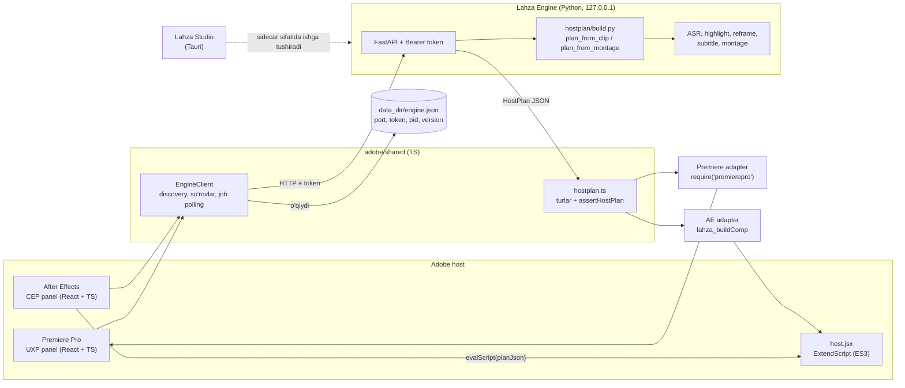

# 12 — Lahza Adobe plaginlari: Premiere Pro va After Effects ichida

> Holat: **loyiha** (2026-10-22). Kod `adobe/` papkasida yozilmoqda; haqiqiy Premiere / After Effects'da hali ishga tushirilmagan.
> Qaror: [ADR-0014](adr/0014-adobe-plaginlar.md). Oldingi kontekst: [`11-montaj-platformasi.md`](11-montaj-platformasi.md) 7-bo'lim (fayl almashinuvi, NLE ko'prigi).
> Belgilar: **ANIQLANSIN** — rasmiy manbada tasdiqlanmagan; birinchi haqiqiy host sinovida (ADB-0) aniqlanadi.

## Mundarija

1. [Maqsad va foydalanuvchi oqimi](#1-maqsad-va-foydalanuvchi-oqimi)
2. [Arxitektura](#2-arxitektura)
3. [Engine'ni topish va o'rnatish variantlari](#3-engineni-topish-va-ornatish-variantlari)
4. [Host-reja `lahza.hostplan/1` va koordinata qoidalari](#4-host-reja-lahzahostplan1-va-koordinata-qoidalari)
5. [Funksiyalar va API cheklovlari](#5-funksiyalar-va-api-cheklovlari)
6. [Xavfsizlik](#6-xavfsizlik)
7. [Tarqatish va imzolash](#7-tarqatish-va-imzolash)
8. [Test strategiyasi](#8-test-strategiyasi)
9. [Xavflar](#9-xavflar)
10. [Ochiq savollar](#10-ochiq-savollar)
11. [Yo'l xaritasi](#11-yol-xaritasi)
12. [Manbalar](#12-manbalar)

---

## 1. Maqsad va foydalanuvchi oqimi

**Maqsad.** Montajchi Premiere Pro yoki After Effects'dan chiqmasdan Lahza'ning tahlil va rejalashtirish qismidan foydalanadi:
video tahlili → transkript va eng yaxshi lahzalar → "Reels yasash" → dastur ichida 9:16 sekvensiya (Premiere) yoki kompozitsiya (AE)
tayyor kesimlar, kadr harakati (Motion/Transform kalit kadrlari) va o'zbekcha subtitr bilan quriladi. Video shablonlar bo'yicha montaj ham
xuddi shu yo'l bilan quriladi. **Render'ni Adobe qiladi** — Lahza bu yo'lda FFmpeg render qilmaydi.

Og'ir hisob (ASR, highlight, reframe, montaj rejasi) mavjud **Lahza Engine**'da (Python, `127.0.0.1`) qoladi va to'liq qayta ishlatiladi.
Desktop ilova **Lahza Studio** ham saqlanadi; ikkalasi bitta engine'dan foydalanadi.

### 1.1 Premiere Pro oqimi (UXP paneli)

| # | Foydalanuvchi | Panel | Engine |
| --- | --- | --- | --- |
| 1 | Window → UXP Plugins → Lahza | Engine holatini ko'rsatadi: topildi / yo'q, versiya, sxema mosligi | `GET /v1/hostplan/schema` |
| 2 | Loyihada klipni yoki sekvensiyadagi klipni tanlab "Tahlil qilish" | Manba fayl yo'lini oladi | loyiha "Premiere" + `/v1/media:import`, job progress |
| 3 | Lahzalarni ko'radi (ball, sarlavha, davomiylik, sabab), qabul / rad qiladi | Ro'yxat | klip holati |
| 4 | "Reels yasash": aspect, imlo, subtitr uslubi | `:hostplan` → adapter | `POST /v1/episodes/{eid}/clips/{cid}:hostplan` |
| 5 | Natija: yangi sekvensiya (1080×1920), kesimlar, Motion kalit kadrlari, captions trek, markerlar | "Nima o'tmadi" ro'yxati | — |
| 6 | Montaj: shablon + loyihadagi bir nechta klip | `/v1/montages` → `:hostplan` → adapter | `POST /v1/montages/{id}:hostplan` |

### 1.2 After Effects oqimi (CEP paneli)

1–4-qadamlar bir xil (manba — AE'da tanlangan footage elementi yoki qatlam manbasi).
5-qadamda `host.jsx` dagi `lahza_buildComp(planJson)` bitta undo group ichida kompozitsiya quradi.
AE'ning kuchli joyi — **karaoke subtitr**: har qator alohida Text qatlami, joriy so'z highlight'i so'z vaqtlaridan (`captions.lines[].words`).

---

## 2. Arxitektura

Qatlamlar:

| Qatlam | Qayerda | Vazifasi | Qilmaydi |
| --- | --- | --- | --- |
| Panel UI | `adobe/premiere/src`, `adobe/after-effects/src` | Holat, tahlil, lahzalar, Reels/montaj tugmalari, "nima o'tmadi" | Hisob, fayl yozish (SRT'dan tashqari) |
| `EngineClient` | `adobe/shared/src/engine.ts` | Discovery, token, xatolar, job polling, hostplan sxema tekshiruvi | Host API |
| Host adapter | `adobe/premiere/src/host/`, `adobe/after-effects/jsx/host.jsx` | `HostPlan` → host API chaqiruvlari | Rejalashtirish |
| Engine hostplan | `engine/src/lahza_engine/hostplan/` | Klip/montaj → `HostPlan` | Host'ga xos API |

**Tamoyil.** Barcha qaror (kesim, kadr, subtitr qatorlari, o'tish xaritasi) engine'da qabul qilinadi. Adapter faqat "tarjimon": rejani o'qiydi
va host API'siga qo'yadi. Shu sabab Premiere va AE natijasi bir xil reja asosida chiqadi va desktop ilovadagi natija bilan mos keladi.

---

## 3. Engine'ni topish va o'rnatish variantlari

### 3.1 Discovery

* Engine `lahza serve --discovery` (yoki `LAHZA_DISCOVERY=1`) bilan ishga tushganda `<data_dir>/engine.json` yozadi:
  `{"port", "token", "pid", "version", "started_at"}`; fayl huquqi `0600`; to'xtaganda o'chiriladi. `--port` berilmasa bo'sh port tanlanadi.
* `data_dir`: macOS — `~/Library/Application Support/Lahza Studio`, Windows — `%LOCALAPPDATA%\Lahza Studio` (`adobe/shared/src/engine.ts` `dataDir`).
* Panel faylni o'qiydi (Premiere: UXP `localFileSystem`; AE: CEP Node `fs`, ixtiyoriy), `parseDiscovery` bilan tekshiradi, `GET /v1/hostplan/schema`
  javobidagi `schema` = `lahza.hostplan/1` bo'lmasa — "Lahza versiyalari mos emas" xabari.
* `pid` tirikligini plagin tekshira olmaydi (UXP'da jarayon API'si cheklangan) — shuning uchun mezon: health so'rovi muvaffaqiyatli bo'lishi.
  Eskirgan `engine.json` (engine yiqilib qolgan) holatida panel "engine javob bermayapti" deydi.

### 3.2 O'rnatish variantlari

| Variant | Kim ishga tushiradi | Afzallik | Kamchilik | Holat |
| --- | --- | --- | --- | --- |
| **A. Lahza Studio o'rnatilgan** | Studio o'z sidecar'ini `--discovery` bilan ishga tushiradi | Modellar, katalog, yangilanish bitta joyda | Studio ochiq turishi kerak | MVP (birinchi) |
| **B. Mustaqil "Lahza Engine" servisi** | macOS LaunchAgent / Windows foydalanuvchi autostart'i | Studio'siz ishlaydi, faqat plagin kerak bo'lganlar uchun | Alohida o'rnatuvchi, yangilash, model menejeri UI'siz | Keyin (ADB-7) |
| **C. Plagin + engine o'rnatuvchisi** | Bitta o'rnatuvchi: `.ccx`/`.zxp` + engine (B) | Bir qadamda o'rnatish | Marketplace "companion app" talablari [U8] | Keyin; B ga bog'liq |

**Muhim cheklov.** Creative Cloud Marketplace ko'rik qoidalari: *plagin tashqi ilovani ishga tushirmasligi kerak (faqat brauzer havolalari)* [U8].
Shuning uchun panel engine'ni o'zi **ishga tushirmaydi** — faqat yo'riqnoma beradi ("Lahza Studio'ni oching yoki Lahza Engine servisini yoqing").
Bu qoida Marketplace'dan tashqari tarqatishda ham saqlanadi (bitta xatti-harakat).

---

## 4. Host-reja `lahza.hostplan/1` va koordinata qoidalari

Manba: `engine/src/lahza_engine/hostplan/model.py` (pydantic) va `adobe/shared/src/hostplan.ts` (TS turlari + `assertHostPlan`). Ikkalasi bir xil bo'lishi shart;
sxema o'zgarsa — `lahza.hostplan/2` va eski versiya plaginlarda aniq xato bilan rad etiladi.

Tuzilma: `sequence` (nom, w, h, fps, audio_hz, duration_s) · `media[]` (absolyut yo'l) · `video[]` (`VideoClipItem`: `src_in/out`, `rec_in/out`, `speed`,
`volume_db`, `mute`, `layers[]`, `transition_in`, `label`) · `music[]` · `captions` (`srt_path`, `words_path`, `lines[]` so'zlari bilan, `style`) ·
`text[]` · `markers[]` · `not_translated[]`.

**Koordinata qoidalari** (ikkala dasturning Motion / Transform modeliga to'g'ridan-to'g'ri mos):

| Qiymat | Ma'nosi | Premiere | After Effects |
| --- | --- | --- | --- |
| `rec_in/rec_out` | Sekvensiya/kompozitsiya vaqti, soniya | Trek elementi joyi | `startTime` / `inPoint` / `outPoint` |
| `src_in/src_out` | Manba fayl vaqti, soniya | Element in/out | `inPoint - startTime` orqali |
| `TransformKey.t` | Element o'z boshidan vaqt, soniya | Kalit kadr vaqti (element boshi + t) | `rec_in + t` |
| `scale_pct` | Manba kadri masshtabi, 100 = asl | Motion → Scale | Transform → Scale `[s, s]` |
| `pos_x, pos_y` | Manba **markazi** sekvensiyaning qaysi pikseliga tushadi | Motion → Position (piksel; ANIQLANSIN: UXP'da normallashtirilgan bo'lishi mumkin) | Transform → Position (piksel), Anchor = manba markazi |
| `crop_rect` | Split uchun ko'rinadigan to'rtburchak, sekvensiya pikselida | Crop effekti (foizga o'giriladi) | Mask yoki `Crop` o'rniga to'rtburchak mask |
| `interp` | `linear` / `hold` / `ease` | Kalit kadr interpolyatsiyasi | `KeyframeInterpolationType` |

Vaqt kadrga host'da moslashtiriladi (Premiere: `TickTime`; AE: `frameDuration`). Reja yangi piksel yaratmaydi ([ADR-0013](adr/0013-haqiqiy-kadr-tamoyili.md)):
faqat kesish, masshtab, siljitish, xiralashtirish va matn.

---

## 5. Funksiyalar va API cheklovlari

### 5.1 Premiere Pro (UXP)

API `require("premierepro")` orqali [U2]. Quyidagi nomlar Adobe'ning rasmiy TS deklaratsiyalarida (`@adobe/premierepro` turlari, Apache-2.0) bor [U3];
haqiqiy xatti-harakat ADB-0 da tasdiqlanadi.

| Funksiya | API (deklaratsiyada bor) | MVP | Izoh |
| --- | --- | --- | --- |
| Tanlangan klip yo'li | `Project`, `ProjectItem`, sekvensiya tanlovi | ✅ | |
| Fayl import | `Project.importFiles` | ✅ | |
| Sekvensiya yaratish | `Project.createSequence`, `createSequenceWithPresetPath` (26.3 dan [U1]) | ✅ | 1080×1920 preset: ANIQLANSIN — preset fayli yoki sozlamalarni o'zgartirish |
| Kliplarni joylash | `SequenceEditor.createInsertProjectItemAction` / `createOverwriteItemAction`, `createSetInPointAction` / `createSetOutPointAction` | ✅ | O'zgarishlar `executeTransaction` / `lockedAccess` ichida |
| Motion kalit kadrlari | `ComponentParam.createKeyframe`, `createAddKeyframeAction`, `createSetTimeVaryingAction` | ✅ | Interpolyatsiya turi: ANIQLANSIN |
| Gaussian Blur (xira fon) | `VideoFilterFactory`, `createComponent(matchName)` | ✅ | matchName: ANIQLANSIN |
| O'tishlar | `TransitionFactory.createVideoTransition(matchName)`, `createAddVideoTransitionAction`, `AddTransitionOptions` | ✅ | matchName'lar: ANIQLANSIN |
| Markerlar | `Markers.createAddMarkerAction` | ✅ | |
| Subtitr | `CaptionTrack` (sekvensiyada `getCaptionTrack`) | ◐ | SRT'ni captions trekiga API orqali import qilish: ANIQLANSIN. Zaxira — foydalanuvchi SRT'ni qo'lda import qiladi (fayl tayyor) |
| Tezlik (`speed`) | `getSpeed()` bor, o'rnatish action'i topilmadi | ✕ → keyin | `not_translated` ga yoziladi |
| Musiqa, ducking | Audio trekka joylash bor; Essential Sound ducking API'si topilmadi | ◐ | Ducking — ANIQLANSIN |
| Lumetri preset, LUT | `createComponent` | Keyin | |
| Zaxira: FCP7 XML | `Project.importFiles` (XML) / `ProjectConverter` | Keyin | Engine'da XML eksporti bor ([ADR-0012](adr/0012-lahza-timeline.md)); UXP orqali XML import: ANIQLANSIN |

Versiya: UXP Premiere'da 25.2 da beta, **25.6 dan rasmiy** [U1][U4]. Tarmoq hujjati minimal talab sifatida Premiere 25.6, UDT 2.2, manifest v5 ni ko'rsatadi [U5].
Ba'zi kerakli API'lar (`createSequenceWithPresetPath`) changelog'da 26.3 da qo'shilgan [U1] — manifest `minVersion` Premiere agentining README'sida yakuniy belgilanadi.

### 5.2 After Effects (CEP + ExtendScript)

CEP 12 After Effects 25.0 dan [U6]. ExtendScript — ES3; domen bilimi `~/.claude/skills/after-effects-assistant/rules/*.md` da.

| Funksiya | AE vositasi | MVP | Izoh |
| --- | --- | --- | --- |
| Tanlangan footage yo'li | `app.project.selection`, `layer.source.file` | ✅ | |
| Import | `ImportOptions`, `app.project.importFile` | ✅ | |
| Kompozitsiya | `app.project.items.addComp(name, w, h, 1, duration, fps)` | ✅ | |
| Qatlamlar, kesimlar | `startTime`, `inPoint`, `outPoint`; tezlik — `stretch` | ✅ | AE'da tezlik ham o'tadi |
| Scale/Position kalit kadrlar | `ADBE Transform Group` → `ADBE Scale`, `ADBE Position`, `setValueAtTime` | ✅ | |
| Xira fon | `ADBE Gaussian Blur 2` | ✅ | |
| Split | Mask (to'rtburchak) | ✅ | |
| O'tishlar | cross_dissolve → opacity kalit kadrlari; dip_to_black → qora solid | ✅ | push/wipe/zoom — keyin yoki `not_translated` |
| Karaoke subtitr | Har qator — Text qatlami; joriy so'z — Text Animator yoki Source Text kalit kadrlari | ✅ | AE'ning asosiy afzalligi |
| Markerlar | `MarkerValue` | ✅ | |
| Musiqa, ducking | Audio Levels kalit kadrlari nutq bo'laklarida | ◐ | |
| Matn overlay | Text qatlami, `position` bo'yicha | Keyin | |
| Lumetri / LUT | `Apply Color LUT` effekti ([`11`](11-montaj-platformasi.md) [A2]) | Keyin | |

**AE'da UXP** — rasmiy sahifa uni beta deb ta'riflaydi ("throughout the beta") [U7]; qaysi AE versiyasidan ekani ko'rsatilmagan (ANIQLANSIN).
2026-07 dagi UXP qo'llab-quvvatlash matritsasida After Effects yo'q [U9]. Shuning uchun AE uchun hozircha CEP ([ADR-0014](adr/0014-adobe-plaginlar.md)).

---

## 6. Xavfsizlik

* **Faqat `127.0.0.1`.** Engine faqat loopback'ga bog'lanadi (mavjud qoida, [`01-arxitektura.md`](01-arxitektura.md)). Plaginlar boshqa hech qanday hostga so'rov yubormaydi.
* **Token majburiy.** `engine.json` dagi token har so'rovda `Authorization: Bearer`; fayl `0600`. CORS token o'rnini bosmaydi.
* **CORS.** CEP sahifasi `file://` dan ochiladi → `Origin: null` (ANIQLANSIN: aniq qiymat haqiqiy AE'da). UXP origin'i — ANIQLANSIN.
  Engine faqat shu ma'lum origin'larga ruxsat beradi, `*` emas.
* **UXP ruxsatlari** (`manifest.json` `requiredPermissions`) [U10]:
  `network.domains` — faqat loopback yozuvi (aniq shakli ANIQLANSIN, pastga qarang); `localFileSystem` — `request` yoki `fullAccess`
  (`engine.json` va import qilinadigan media yo'llari uchun; minimal varianti ADB-0 da tanlanadi); `launchProcess` — **yo'q**; `allowCodeGenerationFromStrings` — `false`.
* **http va macOS.** Adobe tarmoq retsepti: *"macOS restricts `http://` for security reasons"* [U5]. Engine `http://127.0.0.1` da ishlaydi.
  UXP'ning macOS'dagi loopback HTTP'ga munosabati **ANIQLANSIN** — bu ADB-0 ning birinchi tekshiruvi. Forumda IP-manzil yozuvi ishlamagani va `localhost` ishlagani haqida tasdiqlanmagan xabar bor [U11].
  Zaxira variantlar: manifestda `http://localhost:<port>` (port dinamik — wildcard ANIQLANSIN), yoki engine'da lokal TLS (o'z-o'zini imzolagan sertifikat — UXP qabul qilishi ANIQLANSIN).
* **CEP.** Node faqat `engine.json` o'qish uchun (`--enable-nodejs`, mixed context'siz) [U6]. `host.jsx` ga faqat JSON satri uzatiladi, `eval` qilinmaydi (ES3 xavfsiz parse).
* **Fayl yo'llari.** Engine yozadigan fayllar (`.srt`, `_words.json`) faqat foydalanuvchi tanlagan `out_dir` ichida.

---

## 7. Tarqatish va imzolash

| | Premiere (UXP) | After Effects (CEP) |
| --- | --- | --- |
| Paket | `.ccx` (plagin tarkibi zip qilinib `.ccx` deb nomlanadi) [U12] | `.zxp`, `ZXPSignCmd` bilan imzolanadi [U12][U13] |
| Dev yuklash | UXP Developer Tool; Premiere'da Developer Mode yoqiladi [U14] | `PlayerDebugMode`: macOS `defaults write com.adobe.CSXS.12 PlayerDebugMode 1`; Windows `HKCU\Software\Adobe\CSXS.12` → `PlayerDebugMode` = `"1"` (string) [U6]; extensions papkasiga symlink |
| Extensions papkasi | — (Creative Cloud boshqaradi) | macOS: `~/Library/Application Support/Adobe/CEP/extensions`; Windows: `%APPDATA%\Adobe\CEP\extensions` [U6] |
| Foydalanuvchi o'rnatishi | `.ccx` ni ikki marta bosish → Creative Cloud desktop → "faqat ishonchli manbadan" ogohlantirishi → Install [U14] | UPIA orqali (`.zxp`) [U15] |
| CLI o'rnatish (UPIA) | macOS: `./UnifiedPluginInstallerAgent --install <fayl>` (`/Library/Application Support/Adobe/Adobe Desktop Common/RemoteComponents/UPI/...`); Windows: `UnifiedPluginInstallerAgent.exe /install <fayl>` (`C:\Program Files\Common Files\Adobe\...`); admin huquqi kerak bo'lishi mumkin [U14] | Xuddi shu; UPIA ExManCmd o'rnini egallagan [U15] |
| Imzo | `.ccx` uchun alohida kod imzosi talabi hujjatda topilmadi (ANIQLANSIN) | Sertifikat (o'z-o'zini imzolagan ham bo'ladi), **vaqt tamg'asi (`-tsa`) tavsiya etiladi** — aks holda sertifikat muddati tugagach kengaytma ishlamay qolishi mumkin [U13] |

**Creative Cloud Marketplace (Exchange).**

* Har plagin (bepul yoki pullik) ko'rikdan o'tadi; maqsad — 10 ish kunida javob [U8]. Birinchi yuborishdan oldin Developer Distribution portalida nashriyotchi profili [U12].
* Ko'rik talablari (Lahza'ga tegishlilari) [U8]: tashqi ilovani ishga tushirmaslik; tarmoq uzilishini to'g'ri ko'rsatish va qayta ulanishda tiklanish;
  maxfiylik siyosati va foydalanish shartlari URL'lari; **boshqa dasturga bog'liqlikni** (Lahza Studio / Lahza Engine) tavsifda aniq yozish; release notes va sinov yo'riqnomasi;
  lokalizatsiyada matn kesilmasligi. Hybrid (C++) plaginlar uchun macOS arm64 + x64 va Windows x64 binarlari majburiy [U16] — Lahza hybrid emas.
* Pullik: FastSpring orqali, **10% qat'iy komissiya**, kanal eksklyuziv emas [U17].
* Shartlar: Adobe Developer Terms (2024-06-18) — Exchange shartnomasi o'rnini egallagan [U18]. Marketplace'ni yagona kanal qilib cheklash huquqi haqida savol forumda bor, rasmiy javob yo'q (ANIQLANSIN, yurist) [U19].
* Mustaqil tarqatish (o'z sayti, GitHub) — ko'riksiz mumkin [U20].

**Windows / macOS farqlari** (qisqa): data_dir yo'llari (3.1); CEP debug kaliti (plist vs registry); UPIA yo'li va bayroq uslubi (`--install` vs `/install`);
macOS'da UXP `http://` cheklovi (6); fayl yo'llari ajratgichi `HostMedia.path` da engine tomonidan host OS formatida beriladi.

---

## 8. Test strategiyasi

Bu mashinada Premiere ham, AE ham yo'q. Shuning uchun:

| Daraja | Nima | Qayerda | Haqiqiy host kerakmi |
| --- | --- | --- | --- |
| Engine | `plan_from_clip`, `plan_from_montage`: crop → scale/pos matematikasi, o'tish xaritasi, captions, `not_translated` | `engine/tests/` (pytest) | Yo'q |
| Sxema mosligi | Python modeli ↔ `hostplan.ts`: bir xil JSON namunalari ikkala tomonda validatsiya | engine + `adobe/shared` | Yo'q |
| Engine mijozi | `EngineClient` — mock `fetch`, discovery parse, xato matnlari | `adobe/shared`, plaginlar | Yo'q |
| Premiere adapter | **Soxta adapter** (`fake.ts`) — rejadan chiqqan chaqiruvlar ketma-ketligini yozib oladi; snapshot | `adobe/premiere` | Yo'q |
| AE ExtendScript | **ES3 sintaksis** (acorn `ecmaVersion: 3`) + Node'da **soxta AE obyekt modeli** (`app`, `CompItem`, `Layer`, `Property`) bilan `lahza_buildComp` | `adobe/after-effects` | Yo'q |
| UI | typecheck, build, bitta bundle | ikkala plagin | Yo'q |
| Qo'lda sinov | Matritsa (pastda) | haqiqiy Adobe | **Ha** |

**Qo'lda sinov matritsasi** (ADB-8; har katakda: panel yuklanadi, engine topiladi, Reels sekvensiyasi/kompozitsiyasi quriladi, kadr va subtitr vaqti ±1 kadr,
"nima o'tmadi" ro'yxati to'g'ri, undo bir qadamda):

| Host versiyasi | macOS (Apple Silicon) | Windows 11 x64 |
| --- | --- | --- |
| Premiere Pro 25.6 (minimal, ANIQLANSIN) | ☐ | ☐ |
| Premiere Pro 26.x (joriy) | ☐ | ☐ |
| Premiere Pro Beta | ☐ | ☐ |
| After Effects 25.x (CEP 12) | ☐ | ☐ |
| After Effects 26.x (joriy) | ☐ | ☐ |

Etalon materiallar: 16:9 podkast (2 spiker), 4:3 klip, 25 / 29.97 / 30 fps, o'zbekcha subtitr (ʻ ʼ belgilar bilan), 3 ta montaj shabloni.

---

## 9. Xavflar

| Xavf | Ehtimol | Ta'sir | Choralar |
| --- | --- | --- | --- |
| macOS'da UXP `http://127.0.0.1` ni bloklaydi [U5] | O'rta | Yuqori — Premiere paneli engine'ga ulanmaydi | ADB-0 birinchi tekshiruv; `localhost`, lokal TLS variantlari |
| UXP API'si kerakli amalni bermaydi (tezlik, SRT → captions, ducking) | Yuqori | O'rta | `not_translated` + aniq xabar; FCP7 XML zaxirasi |
| Premiere CEP'ni olib tashlashi | — | Lahza'ga ta'sir yo'q (Premiere uchun UXP tanlangan) | — |
| AE'da CEP olib tashlanadi, UXP hali beta | Past-o'rta (rasmiy sana yo'q) | Yuqori — AE paneli ishlamay qoladi | Adapter qatlami ajratilgan; `HostPlan` va UI qayta ishlatiladi; AE UXP rasmiy bo'lganda ko'chirish (ADB-10) |
| Adobe yangilanishi API'ni o'zgartiradi | O'rta | O'rta | Har yangi versiyada matritsa; `minVersion` chegarasi |
| Marketplace rad etadi (tashqi dasturga bog'liqlik, engine o'rnatuvchisi) | O'rta | O'rta | Mustaqil tarqatish; tavsifda bog'liqlikni aniq yozish |
| ZXP vaqt tamg'asi muammolari (ZXPSignCmd ba'zi versiyalarda `-tsa` bilan yiqilgan, forum 2025) [U13] | O'rta | Past | Joriy ZXPSignCmd, boshqa TSA server |
| Engine ishlamayotgan / eskirgan `engine.json` | Yuqori | Past | Aniq holat ekrani va yo'riqnoma |

**CEP kelajagi (tekshirilgan).** Adobe'ning sanali rasmiy hujjati topilmadi. Adobe Community forumida Bruce Bullis (Premiere API bo'yicha Adobe vakili sifatida tanilgan; forumdagi roli — "Legend") 2025-08-08 da yozgan: Premiere'da CEP qo'llab-quvvatlanadi va
*UXP non-beta relizidan keyin bir kalendar yil* qo'llab-quvvatlash rejalashtirilgan [U21]. Bu rasmiy hujjat emas. UXP Premiere'da 25.6 da rasmiy bo'ldi [U4] — demak Premiere'da CEP
25.6 relizidan taxminan bir yil o'tib olib tashlanishi mumkin (aniq sana ANIQLANSIN). AE uchun bunday bayonot topilmadi.

---

## 10. Ochiq savollar

1. macOS'da UXP loopback `http` ga ruxsat beradimi; manifestdagi aniq yozuv (`http://127.0.0.1`, `http://localhost`, port wildcard)? — ADB-0.
2. UXP va CEP so'rovlarining `Origin` sarlavhasi qanday? — ADB-0.
3. Premiere UXP: SRT'ni captions trekiga dasturiy import, tezlikni o'rnatish, ducking, 9:16 sekvensiya preseti — bormi?
4. Premiere manifest `minVersion`: 25.6 yoki 26.3 (`createSequenceWithPresetPath`)?
5. `.ccx` uchun kod imzosi talab qilinadimi (Marketplace'dan tashqarida)?
6. AE UXP qaysi versiyada rasmiy bo'ladi; CEP AE'da qachon to'xtaydi?
7. Mustaqil Lahza Engine servisi (variant B): modellar va katalog yangilanishi Studio'siz qanday boshqariladi?
8. Adobe Developer Terms (2024) va Lahza'ning tijorat litsenziyasi (TZ 19) mosligi — yurist.
9. Plagin va Lahza Studio bir vaqtda bitta engine'dan foydalanganda job navbati va loyiha qulflari.

---

## 11. Yo'l xaritasi

Vazifalar va darvoza [`02-yol-xaritasi.md`](02-yol-xaritasi.md#kengaytma-adobe-plaginlari) da yuritiladi: ADB-0 … ADB-10, darvoza **GA1**.

---

## 12. Manbalar

Tekshirilgan sana: 2026-10-22.

* [U1] [Premiere UXP changelog](https://developer.adobe.com/premiere-pro/uxp/changelog) — 25.2 beta, 25.6 rasmiy, 26.2 hybrid, 26.3 `createSequenceWithPresetPath`, `exportAAF`
* [U2] [Premiere UXP API reference](https://developer.adobe.com/premiere-pro/uxp/ppro-reference/) — `require('premierepro')`
* [U3] [adobe/premierepro-types](https://github.com/adobe/premierepro-types) — `src/premierepro.d.ts`, Apache-2.0 (tekshirilgan versiya 27.0.0-beta.57)
* [U4] [Adobe developer blog: UXP arrives in Premiere](https://blog.developer.adobe.com/en/publish/2025/12/uxp-arrives-in-premiere-a-new-era-for-plugin-development) — "graduated from beta … Premiere 25.6"
* [U5] [Premiere UXP: Network operations](https://developer.adobe.com/premiere-pro/uxp/resources/recipes/network) — macOS `http://` cheklovi, WebSocket faqat mijoz, minimal 25.6 / UDT 2.2 / manifest v5
* [U6] [CEP 12 HTML Extension Cookbook](https://github.com/Adobe-CEP/CEP-Resources/blob/master/CEP_12.x/Documentation/CEP%2012%20HTML%20Extension%20Cookbook.md) — AE 25.0 (CEP 12), Node 17.7.1, PlayerDebugMode, extensions papkalari
* [U7] [After Effects UXP](https://developer.adobe.com/after-effects/uxp/) — beta
* [U8] [Premiere UXP: Review & Guidelines](https://developer.adobe.com/premiere-pro/uxp/plugins/distribution/review-guidelines)
* [U9] [UXP Changelog and Product Support Matrix (2026-07)](https://blog.developer.adobe.com/en/publish/2026/07/uxp-changelog-and-support-matrix)
* [U10] [Premiere UXP Manifest](https://developer.adobe.com/premiere-pro/uxp/plugins/concepts/manifest) — `app: "premierepro"`, `requiredPermissions`
* [U11] [CC developer forum: network permission issue](https://forums.creativeclouddeveloper.com/t/network-permission-issue-attn-adobe-manifest-domain-entry-not-granting-fetch-access/11230) — tasdiqlanmagan foydalanuvchi xabari
* [U12] [Developer Distribution: Submission and Review](https://developer.adobe.com/developer-distribution/creative-cloud/docs/guides/submission/overview) — `.ccx`, ZXP, nashriyotchi profili
* [U13] [ZXP packaging & signing (PDF)](https://developer.adobe.com/developer-distribution/creative-cloud/docs/assets/0379980f3814ab56ee93628055b3d4ad/packaging_signing.pdf); [forum: ZXPSignCmd timestamp xatosi (2025)](https://community.adobe.com/t5/premiere-pro-bugs/zxpsigncmd-sign-process-is-broken-segmentation-fault/m-p/15307452)
* [U14] [Premiere UXP: Install a plugin](https://developer.adobe.com/premiere-pro/uxp/plugins/distribution/install) — `.ccx`, Developer Mode, UPIA
* [U15] [UPIA replaces ExManCmd (2021)](https://blog.developer.adobe.com/en/publish/2021/06/new-command-line-tool-for-plugin-installation-replaces-exmancmd)
* [U16] [UXP: Pass Marketplace review](https://developer.adobe.com/uxp/guides/how-to/distribution/review-guidelines/)
* [U17] [The Adobe Creative Cloud Marketplace](https://developer.adobe.com/premiere-pro/uxp/plugins/distribution/adobe-marketplace) — 10% komissiya, FastSpring, eksklyuziv emas
* [U18] [Adobe Developer Terms (2024-06-18, PDF)](https://wwwimages2.adobe.com/content/dam/cc/en/legal/servicetou/Developer-Terms-en_US-20240618.pdf)
* [U19] [CC developer forum: non-exclusive channel savoli](https://forums.creativeclouddeveloper.com/t/distributing-a-free-edition-outside-the-marketplace-does-the-non-exclusive-channel-still-apply/12071)
* [U20] [Premiere UXP: Independent distribution](https://developer.adobe.com/premiere-pro/uxp/plugins/distribution/independent-distribution)
* [U21] [Adobe Community: "In Premiere Pro 25.6 beta my UXP plug-in does not load"](https://community.adobe.com/bug-reports-733/in-premiere-pro-25-6-beta-my-uxp-plug-in-does-not-load-906630) — B. Bullis, 2025-08-08; [2020 yilgi "Future of CEP" muhokamasi](https://community.adobe.com/questions-628/future-of-cep-685590) — "aniq tugash sanasi yo'q"
